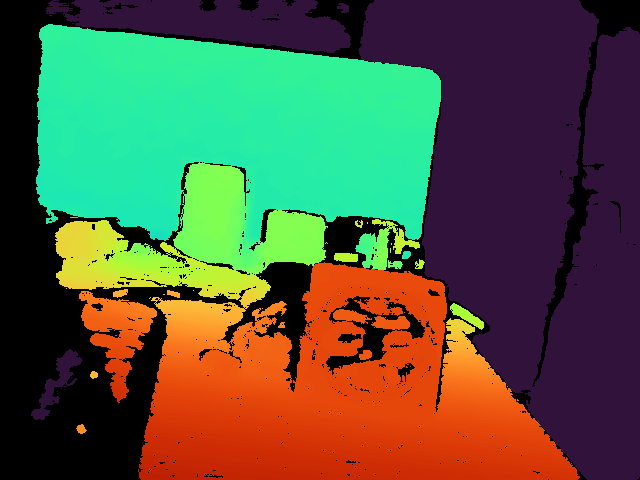

# robot-ev-charging

充电口检测、九孔定位与 PnP 位姿估计，以及面向 **RM75 六维力机械臂 + D435 眼在手 + Windows/Python** 的力觉–视觉插装程序。当前主线是 **D415 采集训练数据 → YOLOv8n 检测 → 九孔/PnP 诊断 → D435 定位与控制**；默认配置不会连接或驱动机器人。

2026-10-31 状态：

| 项 | 当前状态 |
| --- | --- |
| 默认检测器 | `config/vision_model.json` 指向 `runs/detect_split_20261030T110042Z_105be6be/weights/best.pt`，启动校验 SHA256 |
| 训练图库 | `dataset/vision/` 241 条记录：233 ready、1 pending、7 永久排除；154 条已绑定原始深度 |
| 模型权重 | `yolov8n.pt` 与当前 run 的 `weights/best.pt`、`weights/last.pt` 已随 Git 跟踪 |
| 最近训练 | 40 轮，197 train / 36 dev-val；P 0.970、R 0.972、mAP50 0.971、mAP50-95 0.913 |
| 单元测试 | 522 项，命令与结果见 [测试与验证](#测试与验证) |
| 控制程序 | 离线 fixture 可运行；真机标定、载荷限值和力觉模型仍需实验验收 |

本文命令在 2026-10-31 重构时逐条核对：CLI 参数用 `--help` 校验；不依赖硬件的命令已实际执行（结果写在对应章节）；相机与 Kinect 命令标注了所需硬件。

## 环境准备

已验证环境：**Windows + Python 3.12.14**。仓库根目录已带 `.venv`；换电脑时先安装 Python 3.12 再重建。

所有命令直接用 `.venv\Scripts\python.exe` 全路径，**不要激活虚拟环境**。本机开启了 Windows 智能应用控制（Smart App Control），它会在 Authenticode 层面拦截未签名的 `.ps1`，`.venv\Scripts\Activate.ps1` 会报“未对文件进行数字签名”，`Set-ExecutionPolicy -Scope Process RemoteSigned` 也压不住（只有 `Bypass` 能绕过）。不需要为此关闭系统防护。确实想让 `python` 在会话里直接可用时，只加 PATH，不执行脚本：

```powershell
$env:Path = "$PWD\.venv\Scripts;$env:Path"
```

### 安装依赖

本机 `.venv` 由 `uv` 创建，**没有内置 pip**（`python -m pip` 会报 `No module named pip`），安装统一走 `uv`：

```powershell
uv pip install --python .venv\Scripts\python.exe -r requirements-control.txt
uv pip install --python .venv\Scripts\python.exe -r requirements-gpu.txt
```

- `requirements-control.txt`：Python 3.12 的视觉、采集与控制依赖（含 `pyrealsense2`、`Robotic_Arm`）。
- `requirements-gpu.txt`：只在 NVIDIA 机器上追加 CUDA 版 `torch`/`torchvision`，固定官方 wheel 与 SHA256；其他平台按 [PyTorch 官方安装说明](https://pytorch.org/get-started/locally/) 选择版本。

GPU 自检：

```powershell
.\.venv\Scripts\python.exe -c "import torch; print(torch.__version__, torch.cuda.is_available()); print(torch.cuda.get_device_name(0))"
```

本机输出：`2.14.1+cu132 True`，`NVIDIA GeForce RTX 5080`。训练默认 `--device 0`；GPU 不可用会明确报错，有意用 CPU 时加 `--device cpu`。

## D415 预览与采集

以下命令需要连接 D415。2026-10-29/30 的采集会话就是按这些入口产生的（见 `artifacts/d415_preview/`）。

### 相机权限与启动

相机入口需要 `SeSecurityPrivilege`（librealsense 2.59.1 的全局互斥体带 SACL，缺失时报 `CreateNamedMutex returned Mutex_TotalFailure`）。

**非管理员终端**用 `vision.launch` 包一层，首次弹一次 UAC：

```powershell
.\.venv\Scripts\python.exe -m vision.launch vision.preview --depth
```

**管理员终端**可以省掉启动器，直接运行：

```powershell
.\.venv\Scripts\python.exe -B -X utf8 -m vision.preview --depth
```

同一规则适用于所有相机命令：非管理员时把 `-m vision.preview` / `-m vision.collect` 换成 `-m vision.launch vision.preview` / `-m vision.launch vision.collect`。`vision.launch` 只给**当前进程**启用权限，不改系统设置、不落盘；原理与安全边界见 [Windows 权限说明](docs/windows_realsense_privilege.md)。

查看设备型号与完整序列号：

```powershell
.\.venv\Scripts\python.exe -B -X utf8 -m vision.collect --list-devices
```

默认绑定 D415 `349222063070`；换设备时在启动命令后加 `--serial 完整序列号`。D435 的机器人定位入口见 [视觉模块说明](vision/README.md)，不使用这里的 D415 预览入口。

### 窗口与显示项

启动后打开两个窗口：

| 窗口 | 显示内容 |
| --- | --- |
| `D415 Visual Diagnostics` | 原始彩色画面、检测框、孔位候选、孔名、重投影点、逐孔残差及 mean/RMS/max |
| `D415 Depth Diagnostics` | 原生深度图、有效深度比例、双流时间差、目标区域距离、候选表面平面法向及 PnP 一致性 |


上图是 2026-10-29 的暂停画面（当时 1280×720/15 fps 配置）：未检出充电口，状态 `scene_only`，只显示场景深度。窗口里的颜色是按 0.15–1.50 m 截断的**伪彩色显示**，黑色表示没有有效测量；数值以原始 Z16 为准（保存后从 `depth/frame_000001.png` 读取）。检出目标后，ROI 覆盖、ROI 距离和候选平面项才会出现数值。

| 显示项 | 含义 | 什么时候有值 |
| --- | --- | --- |
| 原生深度图 | 640×480 原始 Z16 的伪彩色显示，范围 0.15–1.50 m；超范围只截断颜色 | 深度帧可用时 |
| RGB 帧 / 深度帧 | 两路各自的设备帧号，不要求相等 | 总是 |
| 配对时间差 | 两路设备时间戳之差；超过 40 ms 拒绝该次深度结果 | 两路都有时间戳时 |
| 原生深度有效比例 | **整幅 640×480** 中非零 Z16 像素的占比 | 收到深度帧时 |
| 场景深度中位数 | 全幅有效像素的距离中位数 | 至少有一个有效像素时 |
| ROI 测量覆盖 | 内缩检测框内收到投影测量的不同 RGB 像素 ÷ 内缩 ROI 像素；分母是 ROI 像素，不是整幅图 | 检出目标时 |
| ROI 距离 | 框内投影点在彩色相机坐标系的 Z 中位数；不是机械臂到插装目标的距离 | 检出目标且有投影点时 |
| 候选法向 / 平面 RMS | 候选平面通过接受条件后的法向与残差 | 平面通过时 |
| PnP 法向差 / 参考点到平面 | 候选平面与 PnP 位姿的一致性 | 平面与位姿都可解时 |

**2026-10-30 实拍示例**：新模型检出 1 个接口框，置信度 0.9453；9 个可见孔均有定位，孔名关联通过，PnP 内点为 9/9。该帧重投影平均 **1.561 px**、RMS **1.649 px**、最大 **2.441 px**，通过当前视觉质量检查。

[](docs/assets/readme/current_nine_hole_detection.png)

这是一帧的诊断结果，孔名依据配置模板，物理极性仍需与样件核对。SDK 内参与名义共面几何尚未独立验收，低重投影残差不代表毫米级精度或插装成功。同一帧的深度可以测量，但候选平面没有通过接受条件，见 [实测与适用边界](#实测与适用边界)；深度没有作为额外通道参与 YOLO 训练。

原图与诊断保存在 `artifacts/d415_preview/20261030T113406Z_08daa1e7cb41483aa29c681ddc53910a/`。历次微调和旧图对照保留在 [黑色打印件实验记录](docs/black_connector_finetune.md)。

USB3 预览默认彩色 **1920×1080 / 30 fps**，深度 **640×480 / Z16 / 30 fps**。加 `--quality hd` 使用 **1280×720 / 30 fps**。每次从实际流读取并保存对应内参；启动失败不会自动更换分辨率。内参不要求先拍标定板，SDK 参数与名义几何仍标为未独立验证。

黑色打印件推荐加 `--zoom` 放大唯一检测目标以观察孔口：

```powershell
.\.venv\Scripts\python.exe -B -X utf8 -m vision.preview --depth --zoom
```

窗口分别显示实测采集 FPS、分析 FPS 和帧年龄。采集线程持续取最新完整帧，分析线程保持图像、检测框、孔位和深度一致；30 fps 是请求的采集速率，不等于完整分析速率。曝光、档位及参数记录详见 [USB3 清晰度和曝光调节](docs/d415_data_collection.md#usb3-清晰度和曝光调节)。

只看彩色视觉、暂不开深度：

```powershell
.\.venv\Scripts\python.exe -B -X utf8 -m vision.preview
```

快速检查双流、自动保存第一组分析结果并在分析三帧后退出：

```powershell
.\.venv\Scripts\python.exe -B -X utf8 -m vision.preview --depth --frames 3 --save-first
```

### 按键与采集流程

1. 启动后终端会打印本次会话目录；等第一帧分析完成，面板不再显示“处理中”。
2. 把充电口放进画面，让检测框稳定包住接口；需要放大时按 **Z**。
3. 按 **F6** 冻结两个窗口的画面；后台仍在取帧，但保存的始终是冻结的这一帧。
4. 按 **F5** 保存：RGB 原图、叠加图、诊断 JSON；深度模式下再加该帧配对的原始深度。
5. 记下终端打印的目录，按 **Esc** 结束会话；关闭任一窗口也会退出。

| 按键 | 操作 |
| --- | --- |
| **F5** | 保存当前已分析帧；深度模式同时保存配对原始深度 |
| **F6** | 暂停/继续两个窗口 |
| **Esc** | 结束会话、写完成清单、释放相机 |
| **Z** | 全画面 / 检测目标局部放大（保存仍是全分辨率原图） |
| **A** | 切换 RGB 自动/手动曝光 |
| **[ / ]** | 减少/增加曝光（转入手动） |
| **- / =** | 减少/增加增益（转入手动） |

首次分析完成前按 F5 只提示等待；同一帧重复保存会跳过；没有检测到目标、孔位关联失败或 PnP 失败也能保存，便于排查。字母和符号键需英文输入法，也支持空格/S 保存、P 暂停、Q 退出。暂停时先按 F6 恢复再调曝光；本次改动的 RGB 参数在退出时恢复。调高曝光会增加运动拖影，调高增益会增加噪声，以实际孔口细节为准。

采集打印件时可加批次、样件和拍摄说明；以下编号仅为示例，应替换为实际编号：

```powershell
.\.venv\Scripts\python.exe -B -X utf8 -m vision.preview --depth --batch d415_session01 --specimen print_dev01 --printing-batch print_batch01 --notes "打印件，正视，室内光照"
```

### 保存内容与深度读取

每次启动都会在 `artifacts/d415_preview/` 下新建唯一会话目录，终端打印完整路径。深度模式下，一个会话里主要有：

| 路径 | 内容 | 什么时候有 |
| --- | --- | --- |
| `images/frame_000001.png` | 1920×1080 RGB 原图，无叠加 | 每次 F5 |
| `overlays/frame_000001.png` | 诊断叠加图，显示尺寸，不是原图 | 每次 F5 |
| `depth/frame_000001.png` | **原始 uint16 Z16**，640×480，未对齐、未滤波、未补洞 | 深度模式且该帧收到深度 |
| `diagnostics/frame_000001.json` | 同帧视觉结果、残差，以及 `depth`（统计/ROI/平面）和 `depth_capture`（文件、帧号、哈希、时差） | 每次 F5 |
| `camera.json`、`depth_camera.json`、`manifest.json`、`preview_manifest.json` | 彩色/深度内外参、RGB 清单、来源与哈希 | 会话开始时创建，保存后更新 |

**原始深度是测量，伪彩色只是显示。** 米值 = 像素值 × `depth_camera.json` 里的 `depth_scale_m`（本机 0.001）。不能把原始 PNG 当 8 位灰度图直接看，也不能从伪彩色图反算回原始深度：

```python
import cv2, json, numpy as np
s = "artifacts/d415_preview/实际会话目录"
depth = cv2.imread(f"{s}/depth/frame_000001.png", cv2.IMREAD_UNCHANGED)  # uint16
scale = json.load(open(f"{s}/depth_camera.json", encoding="utf-8"))["depth_scale_m"]
valid = depth[depth > 0]
print("有效比例", round(valid.size / depth.size, 4))
print("场景中位距离 mm", round(float(np.median(valid)) * scale * 1000, 1))
```



上图和窗口颜色都由同一份原始数据按 0.15–1.50 m 生成：超出范围只截断颜色，黑色是无有效测量。**伪彩色不能反算原始深度，也不能用于测量**；测量只认 `depth/frame_000001.png`。会话里的可用深度还会按图像 SHA 复制进统一图库 `dataset/vision/depth/`，训练仍只读 RGB。

配对与对齐：

- RGB 与深度按**同名**配对（`frame_000001`），但两路帧号不要求相等；配对是否成立由 `diagnostics` 里的帧号、时间戳和 40 ms 阈值决定。
- 深度 640×480 与彩色 1920×1080 **没有对齐**；同名只表示同一帧，不表示同一像素。
- 是否真的写入深度，看 `diagnostics/*.json` 的 `depth_capture.available`、`file`、`file_sha256` 和 `raw_pixels_sha256`。

预览默认 `split=unknown`，自动孔位不是人工真值。会话结束后，按 [九孔复核流程](docs/d415_data_collection.md#接入九孔复核) 用其 `manifest.json` 生成复核页；逐文件说明和元数据见 [D415 数据采集说明](docs/d415_data_collection.md#可选深度辅助诊断)。

### 参数

| 参数 | 默认配置 | 用途 |
| --- | --- | --- |
| `--capture-config` | `config/d415_preview_usb3.json` | D415 身份、彩色分辨率、帧率、预热与 RGB 选项 |
| `--depth-config` | `config/d415_depth_usb3.json` | 深度流与配对时间差阈值；仅在 `--depth` 时生效 |
| `--quality` | 遵循采集配置 | `full-hd` 显式选择 1080p/30，`hd` 选择 720p/30 |
| `--vision-config` | `config/d415_preview.json` | D415 检测/PnP 参数；通过 `config/vision_model.json` 读取当前模型 |
| `--geometry` | `config/geometry_nominal.json` | 孔位几何；使用实测几何时需匹配 `--specimen` 和 `--printing-batch` |
| `--output-root` | `artifacts/d415_preview` | 自定义会话根目录，必须在项目目录内 |
| `--library` / `--no-library` | `dataset/vision` | 保存时自动入图库；诊断会话可用 `--no-library` 退出入库 |
| `--serial` | 采集配置 | 显式指定 D415 序列号 |

### 实测与适用边界

两次真实采集的结果：

| 会话 | `status` | 整幅有效 Z16 | 场景中位 | 配对时差 | ROI 投影覆盖 | ROI 彩色 Z 中位 | 候选平面 |
| --- | --- | --- | --- | --- | --- | --- | --- |
| 2026-10-29 暂停帧 | `scene_only` | 73.6% | 970.0 mm | 0.80 ms | — | — | 未拟合（未检出目标） |
| 2026-10-30 19:34 帧 | `plane_rejected` | 80.37% | 1013.0 mm | 16.8 ms | 15.9% | 378.6 mm | 内点 52.0% < 85%，拒绝 |

第二行的准确表述：**ROI 深度可以测量**（内缩框内投影覆盖 15.9%，分母是 ROI 像素），但**候选平面没有通过**（内点比例 52.0%，低于 85% 的接受阈值），所以 `status` 是 `plane_rejected`、`reason` 是 `mixed_or_nonplanar_surface`，没有输出法向和 PnP 一致性。整幅 640×480 中有 246,897 个非零 Z16 像素（80.37%）；378.6 mm 是框内投影点的彩色相机 Z 中位数，不是机械臂到插装目标的距离，也不能当插入深度。

- 能得到：同帧配对的场景距离、目标区域的测量覆盖，以及平面通过时的法向与 PnP 一致性检查。
- 不能得到：替代九孔定位或 PnP 位姿；作为插装距离或安全限值；黑色打印件上覆盖只有 7.27–8.18%（六帧回放），不足以确定孔口平面。

`depth.status` 只有 5 个值，和 `depth.reasons[]` 是两个字段：

| `status` | 含义 | 典型 `reasons[]` |
| --- | --- | --- |
| `invalid` | 本次深度不可用，只保留 RGB 诊断 | `missing_depth`、`no_valid_depth`、`depth_pair_skew_exceeded`、`depth_timestamp_domain_mismatch` |
| `scene_only` | 有场景深度，但没有检测到目标 | `target_not_detected` |
| `roi_insufficient` | ROI 内可拟合表面点少于 80 | `insufficient_surface_samples` |
| `plane_rejected` | 候选平面未通过接受条件 | `mixed_or_nonplanar_surface`、`noisy_or_mixed_surface`、`insufficient_plane_spatial_support` |
| `candidate_plane` | 候选平面通过，才输出法向与 PnP 一致性 | `aperture_plane_identity_unverified` |

`reasons` 是数组，可以同时有多条，完整列表随 `diagnostics/*.json` 保存。`candidate_plane` 也会带 `aperture_plane_identity_unverified`，提醒检测框不能确认哪个台阶是建模孔口面。

补充边界：

- 深度黑色区域表示无效测量；有效比例只统计非零 Z16，不代表精度。未检测到充电口时只显示场景深度，ROI 覆盖、ROI 距离和平面项为 `--`。
- 候选平面来自检测框内的表面点，不同台阶或孔底不一定属于建模孔口平面；它不能证明 PnP 正确，也不修正重投影残差。
- 拍显示屏只能测到屏幕实际表面，不能重建屏幕里的虚拟模型；验证目标平面要用实体打印件。
- 权重缺失/哈希不符、型号或序列号不符、指定流启动失败：按终端错误处理；已建立的会话会记录失败状态。

深度结果只用于诊断，不驱动机械臂；SDK 参数未独立验证。实测限制与验证范围见 [实现与验证记录](docs/implementation_validation.md)，采集与复核说明见 [D415 数据采集说明](docs/d415_data_collection.md)。

### 只采集 RGB 训练图

不运行检测/PnP、只采集原图时使用：

```powershell
.\.venv\Scripts\python.exe -B -X utf8 -m vision.collect --batch d415_session01 --split unknown --notes "打印件，多角度"
```

这个入口使用**空格/S 保存、Q/Esc 退出**，输出在 `artifacts/captures/`；F5/F6 和深度功能属于上面的 `vision.preview`。原图与参数的划分、复核和训练衔接见 [采集说明](docs/d415_data_collection.md)。`vision.collect` 也支持 `--list-devices`、`--device-model D435`、`--max-images`、`--interval` 和 `--library/--no-library`。

## 统一图库与标注

### 图库结构

所有充电接口原始 RGB 统一放在 `dataset/vision/`，按日期整理；旧 `yolo_port` 已迁移移除。日期只用于整理，**每轮训练使用完整 train 集，每次验证使用完整 val 集，两者合起来覆盖全部可用图片**。完全相同的文件按 SHA256 合并为一张，所有原始路径保存在来源记录中；检测叠加图、深度彩图、训练拼图和裁剪副本不重复当作原图。

```text
dataset/vision/
├─ images/2026-10-30/   # 原始 RGB 副本；无日期的旧图在 historical/
├─ depth/2026-10-30/    # 与图绑定的原始 uint16 Z16 深度；未对齐、未补洞
├─ labels/2026-10-30/   # 对应 YOLO 框；类别 0 = port
├─ records/             # 每图 SHA256、来源、标注状态、冲突历史、排除原因、深度绑定
├─ source_annotations/  # 历史51份Labelme JSON、79份YOLO标签及1份YAML原件
└─ sync_report.json     # 最近同步数量、深度统计与状态
```

深度按图像 SHA 存到 `depth/<日期>/<sha>.png`，记录里绑定文件/像素双哈希、深度尺度、双流帧号和失败原因；**YOLO 训练仍只用 RGB 和框**。

当前库状态（`vision.training_library status` 去掉 `library` 路径后的实际输出）：

```json
{"total": 241, "with_depth": 154, "ready": 233, "pending": 1, "conflict": 0, "excluded": 7}
```

2026-10-30 本轮训练快照使用 **233 张可训练接口图，7 条永久排除记录**。首次汇总为 245 份来源文件→240 张唯一 RGB；用户随后明确保留删除 10 月 28、29 日的副本，永久排除其中 6 张桌面图及 1 张显示屏模型图。同步不会恢复这些已排除副本。`yolo_port` 的 63 张 train＋16 张 val 全部纳入来源清单，精确重复合并后保留 74 张历史原图。已补齐新接口图标注并解决 5 组同图异框；新框由助手目视检查，`human_reviewed=false`，可继续人工修订。此后新采集的图片先进入待标注状态，不计入这次训练成绩。

### 同步与状态

图库同步、状态检查和深度检查：

```powershell
.\.venv\Scripts\python.exe -B -X utf8 train/python/prepare_port_library.py
.\.venv\Scripts\python.exe -B -X utf8 -m vision.training_library status
.\.venv\Scripts\python.exe -B -X utf8 -m vision.training_library depth-status
```

同步会检查已迁移来源、已有 v2 复核标签，以及 `artifacts/captures`、`d415_preview`、`d415_sdk_apply`、`d415_live_check`、`d415_usb3_recheck`、`d415_preview_upgrade` 下的原始 RGB 与配对深度。旧文件名通过 `config/legacy_photo_index.json` 映射到统一图库，删除旧目录后仍可追溯。其他位置的充电接口原图通过 `--source "原图文件夹"` 导入，该入口只接收 RGB 照片；深度由会话同步导入，不要手动指向深度目录。自定义采集输出目录发生入库失败时，同样用 `--source` 补录。

`depth-status` 的输出形如 `{"records": 241, "with_depth": 154, "conflicts": 0, "problems": []}`；`problems` 非空表示图库里的深度绑定与记录不一致，需要先修复再训练。

### 补标注

以下命令生成可编辑复核页；预标框不会直接写成有效标签。打开页面，在图上拖动添加框，或编辑下方归一化 YOLO 坐标，逐张点击“确认框并下一张”；无接口图点击“无接口，排除”。导出前不要关闭页面，未导出的编辑仅保留在当前页面中。

```powershell
.\.venv\Scripts\python.exe -B -X utf8 train/python/prepare_port_library.py --review artifacts/port_library_review.html
Start-Process artifacts/port_library_review.html
# 在页面导出 reviewed_port_boxes.json 后，按实际下载路径导入：
.\.venv\Scripts\python.exe -B -X utf8 -m vision.training_library annotate --review-json "$env:USERPROFILE\Downloads\reviewed_port_boxes.json"
```

预标注默认使用 `config/vision_model.json` 中的当前模型；加 `--no-suggestions` 可直接手动画框，`--weights 本地文件.pt` 可显式选择其他权重。需要重新检查全部已有标签时加 `--all`；已删除副本的永久排除记录不会生成空白图片页。不要直接改库内标签文件；通过复核页导入才能同步标签哈希和修改历史。页面标的是目标框，九孔身份与中心仍使用独立的九孔标注流程。

### 固定划分

已登记组内的新图继承原集合；未知组不会被静默分配。补完标注后，先查看待分组项，再复制输出中的实际 `group_id` 分配到 train 或 val。相邻或重叠的采集应属于同一组；已固定组不能用此命令随意换集合。

```powershell
.\.venv\Scripts\python.exe -B -X utf8 -m train.python.dataset_split --list-pending
# 将实际 group_id 替换成上一步输出的完整值：
.\.venv\Scripts\python.exe -B -X utf8 -m train.python.dataset_split --assign-group "实际group_id" --split train
```

固定划分在 `config/port_dataset_split.json`：**197 张 train、36 张 val（84.5% / 15.5%）**。相邻 03:13–03:15 三个会话的 139 张保持同一组；另外三个采集组整体进入 val。历史 74 张没有可靠会话记录，保留原有 58/16 分组，因此 val 是**开发验证集，不宣称严格独立测试集**。

## 训练与模型发布

### 训练

当前默认通用 `yolov8n.pt`、GPU 0、640 输入、batch 16、40 轮；全部 train 图每轮参与采样，val 只参与开发验证。初始权重校验为本项目登记的通用预训练文件，不把已训练过验证图片的微调权重误当作通用权重。

```powershell
# 只检查并生成完整冻结快照，不启动训练：
.\.venv\Scripts\python.exe -B -X utf8 train/python/train_port.py --prepare-only
# 正式全量训练（另建一次独立快照和输出目录）：
.\.venv\Scripts\python.exe -B -X utf8 train/python/train_port.py
# 明确指定 GPU、轮数和 batch；不恢复旧微调权重：
.\.venv\Scripts\python.exe -B -X utf8 train/python/train_port.py --epochs 40 --batch 16 --device 0
```

启动前自动同步并检查全库；有待标注、未分组、冲突、损坏、哈希不符或未登记图片时会报错，**不会静默跳过后宣称全部覆盖**。每次新建独立的训练目录，复制冻结原图、标签、划分及初始权重；快照中有独立的 `dataset/images/train`、`dataset/images/val` 和配套 labels。检查实际加载的图片与框、集合无重叠、train＋val 覆盖全部 ready 图。`epoch_coverage.jsonl` 要求每张 train 图每轮恰好作为主样本采样一次，尾批保留；另核验完整 val 覆盖。Mosaic 额外拼接图片不计入主样本次数，随机增强可能裁掉部分目标。训练开始后新增照片进入下一次快照。

### 输出与发布

输出目录包含 `training_manifest.json`（图片和来源）、`training_report.json`（完成状态和参数）、`epoch_coverage.jsonl`、`validation_coverage.jsonl`、`weights/best.pt`、`weights/last.pt`。全部指定轮数、覆盖和权重检查成功后，训练入口才原子更新 `config/vision_model.json`；失败或中断不会替换当前模型。重新启动各视觉进程后使用更新后的模型，已经运行的窗口继续使用启动时加载的模型。

2026-10-30 已在 **RTX 5080** 完成 40 轮训练，输出为 `runs/detect_split_20261030T110042Z_105be6be/`。40 轮均为 197/197 主样本覆盖，共 7,880 次；40 轮验证及最终 best 验证均为 36/36。最佳权重的开发验证指标：Precision **0.97011**、Recall **0.97222**、mAP50 **0.97111**、mAP50–95 **0.91302**。这是目标框检测结果，不是九孔或插装精度；历史会话不明及助手框未经用户复核的限制仍然存在。数据/标签/权重哈希与覆盖核验见同目录 `post_training_audit.json`。

日常预览仍使用同一条短命令；每轮独立保存的 `preview_config.json` 固定当轮权重，供历史实验回放：

```powershell
# 日常使用当前模型：
.\.venv\Scripts\python.exe -B -X utf8 -m vision.preview --depth
# 复现特定训练轮次时，替换为实际 detect_split_... 目录名：
.\.venv\Scripts\python.exe -B -X utf8 -m vision.preview --depth --vision-config "runs/本轮目录/preview_config.json"
```

现在的 36 张 val 不进入本轮优化器训练，但会用于选模，不能称为最终独立测试成绩。YOLO 仍只使用 RGB 和目标框，深度没有作为额外通道输入。最终泛化评价需要另拍独立样件/会话并冻结为 test，不参与训练或选模。

## 离线控制与仿真

控制程序的配置、标定和真机运行步骤见 [控制与实验运行说明](docs/control_usage.md)。离线仿真不连接硬件：

```powershell
.\.venv\Scripts\python.exe -B -X utf8 -m control.simulate --scenario nominal
```

实际输出（`nominal`、method B）：`success: true`、`reason: mechanical_insertion_complete`、`cycles: 393`、`stop_confirmed: true`。可用场景见 `--help`：`nominal`、`blocked`、`overload`、`stale`、`disconnect`、`no_contact`、`bad_vision`、`risk_outside`、`feedback_lag`、`period_jitter`、`trial_timeout`、`observation_drift`、`confirmation_blocked`。

新控制程序消费 `dataset/live/latest_control_pose.json`；D415 预览不写入该控制文件。

## 测试与验证

完整单元测试：

```powershell
.\.venv\Scripts\python.exe -B -X utf8 -m unittest discover -s tests -v
```

本机 **522 项**。其中 519 项在受限沙箱里直接通过；`test_full_pool_training` 和两个 `test_print_geometry` 用例需要命名管道或临时目录权限，在沙箱中报 `WinError 5`，放开限制后相关 16 项全部通过。

图库一致性检查（有待标注/冲突项时会列出并以非零码退出；当前有 1 张 pending，所以现在运行会失败）：

```powershell
.\.venv\Scripts\python.exe -B -X utf8 train/python/check_yolo_dataset.py
```

语法检查：

```powershell
.\.venv\Scripts\python.exe -m py_compile live\python\latest_candidate_contours.py live\python\layout_prior.py live\python\center_fit.py live\python\pnp2.py
```

## 历史图片批量评估

不要只用单张样例调参数。批量评估脚本可一次跑多张原图，统计每张图的 ROI、边缘、候选孔位、布局完整性和 PnP 误差：

```powershell
.\.venv\Scripts\python.exe -B -X utf8 live\python\batch_pipeline_eval.py --max-images 50
```

默认输入目录是 `dataset/vision/images/historical`（迁入 Git 的历史 Kinect 图片），使用固定历史内参；本机 2 张试跑输出：

```text
total: 2  ok: 0  warn: 0  fail: 2
median reproj px: 12.82
failure categories: layout_incomplete(2), small_holes_missing(2), pnp_failed(1), big_hole_or_outer_ring_unstable(1)
Saved: artifacts/batch_eval/20261030_235732
```

历史 79 张样张在 hybrid 边缘模式下的旧版记录为 `OK 29 (36.7%) / Warn 49 / Fail 1`、中位重投影 17.0 px，不能与迁移去重后的 74 张或当前 D415 模型直接比较。推荐 hybrid 边缘模式：

```powershell
$env:VISION_EDGE_METHOD='hybrid'
.\.venv\Scripts\python.exe -B -X utf8 live\python\batch_pipeline_eval.py --max-images 50
```

指定自己的图片目录：

```powershell
.\.venv\Scripts\python.exe -B -X utf8 live\python\batch_pipeline_eval.py --image-dir path\to\images --max-images 30
```

输出在 `artifacts/batch_eval/YYYYMMDD_HHMMSS/`（`summary.csv`、`failures.csv`、`details.json`）。失败分类：`roi_missing`、`roi_low_score`、`roi_suspicious_size`、`canny_too_sparse`、`canny_too_noisy`、`layout_incomplete`、`small_holes_missing`、`big_hole_or_outer_ring_unstable`、`pnp_failed`、`pnp_reproj_warn`、`pnp_point_matching_unstable`。需要失败样例导致非零退出码时加 `--strict-exit`。

批量评估使用 Kim et al. (2016) 的 Kinect v2 RGB 近似内参（`config/camera_intrinsics.json`：fx=1053.62、fy=1047.51、cx=950.39、cy=527.34，plumb_bob 5 参数），**不要混入 D415/D435 图片评价重投影误差**；PnP 使用原图坐标，ROI 中心会先映射回 1920×1080 再求解。

## 目录结构

```text
robot-ev-charging/
├─ config/                 运行时、训练、相机、模型点配置
├─ dataset/
│  ├─ vision/              统一图库：原始 RGB、深度、标签、records、来源记录（Git 跟踪）
│  └─ live/                运行时输入输出（Git 忽略）
├─ vision/                 D415/D435 采集、预览、深度诊断、模型配置
├─ train/
│  ├─ python/              图库同步、划分、训练、数据检查
│  └─ cpp/                 Kinect 训练图采集源码（历史）
├─ live/
│  ├─ python/              在线视觉流水线（历史 Kinect）与批量评估
│  └─ cpp/                 Kinect 采集源码（历史）
├─ control/                力觉–视觉控制、实验与离线验证
├─ artifacts/              采集会话与诊断输出（Git 忽略，少量文档证据例外）
├─ runs/                   YOLO 训练输出（仅 weights/best.pt、last.pt 跟踪）
└─ docs/                   说明、实验记录与论文图表
```

## 已知限制

- RGB 相机内参仍需要替换为当前设备的真实标定结果；D415/D435 各自会话记录内参，不改写 `config/camera_intrinsics.json`。
- 当前验证主要基于已有 live 样张，新光照和新视角还需要继续测试。
- 深度只作诊断与证据，不作为孔位中心检测的主输入，也不进入 YOLO 训练。
- val 是开发验证集，不是独立测试集；最终泛化评价需要另拍独立样件/会话。
- 真机手眼标定、载荷限值、力觉模型和插装效果仍需实验验收；默认配置不连接、不驱动机器人。
- 部分历史源码注释仍有编码乱码，后续可以继续清理。

## Git 跟踪策略

**跟踪：**

- 源码、`config/`、`docs/`（含论文图表）。
- `dataset/vision/`：图库原始 RGB、深度、标签、records、来源记录和 `sync_report.json`（训练数据以 Git 为准）。
- 权重：`yolov8n.pt`、`runs/*/weights/best.pt`、`runs/*/weights/last.pt`。
- `artifacts/d415_preview/` 中少量被文档引用的证据会话，以及 `artifacts/software_validation/`、`artifacts/control_validation_v2/` 的关键报告。

**忽略：**

- `dataset/live/`（运行时交换文件）。
- `artifacts/` 其余内容（采集会话、批处理输出、日志）。
- `runs/` 中除上述权重外的全部内容（训练快照 `dataset/`、`args.yaml`、`results.csv`、`initial.pt` 等；`initial.pt` 与 `yolov8n.pt` 字节相同，需要时复制即可）。
- `*.cache`、`__pycache__/`、`.venv/`、C/C++ 编译产物（`*.exe`、`*.obj`、`*.pdb`、`*.ilk`）。

换电脑后，`git clone` 已包含图库与已发布权重；采集会话和批处理产物仍在本地 `artifacts/`，需要时单独复制。

## 附录：历史 Kinect 流程

`live/cpp/`、`live/python/`、`train/cpp/` 和 `config/camera_intrinsics.json` 保留的是 2026-10 之前的 Kinect v2 采集与实时流水线，需要 Microsoft Kinect SDK v2、Kinect 设备以及自行编译的采集程序（仓库不含 `.exe`）。当前 D415 流程不依赖它们。

历史流水线的步骤、质量报告、内参工具和深度探针说明见 [实现与验证记录](docs/implementation_validation.md)、[视觉优化记录](docs/vision_optimization.md) 与 [视觉模块说明](vision/README.md)；批量评估仍可用这批历史图片运行（见上节）。
