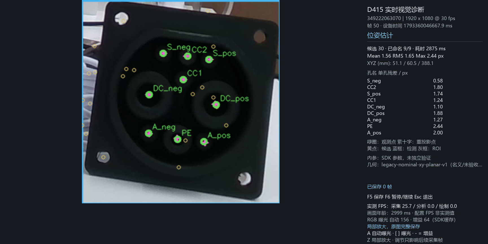
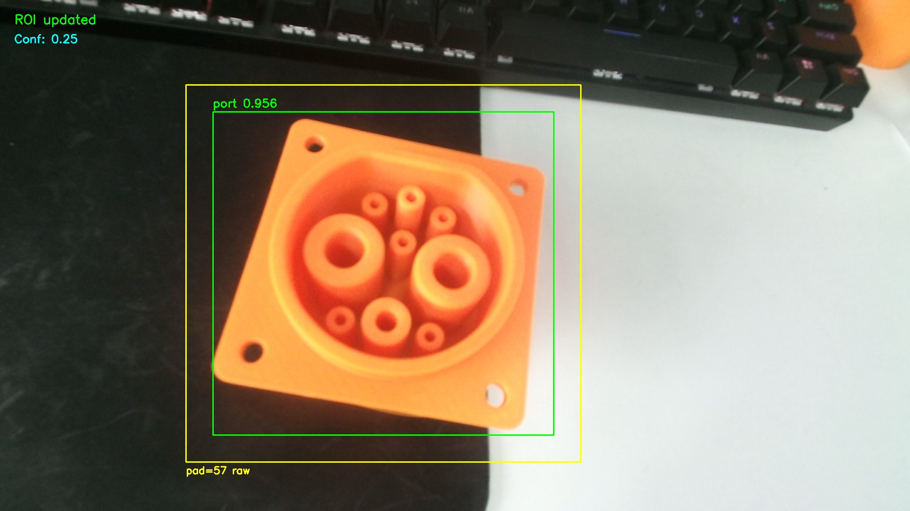
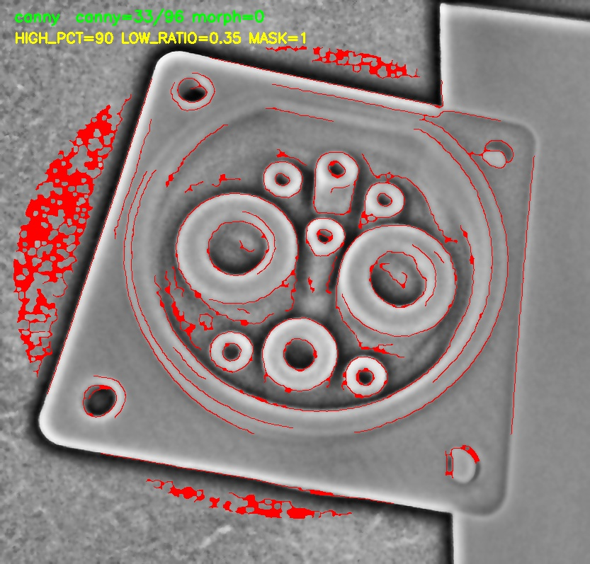
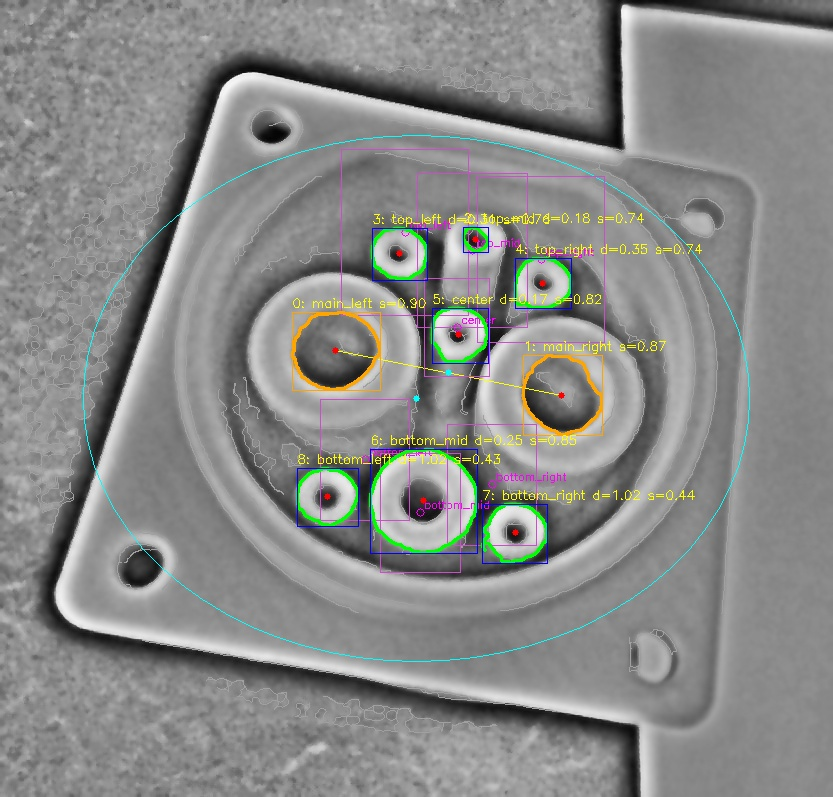
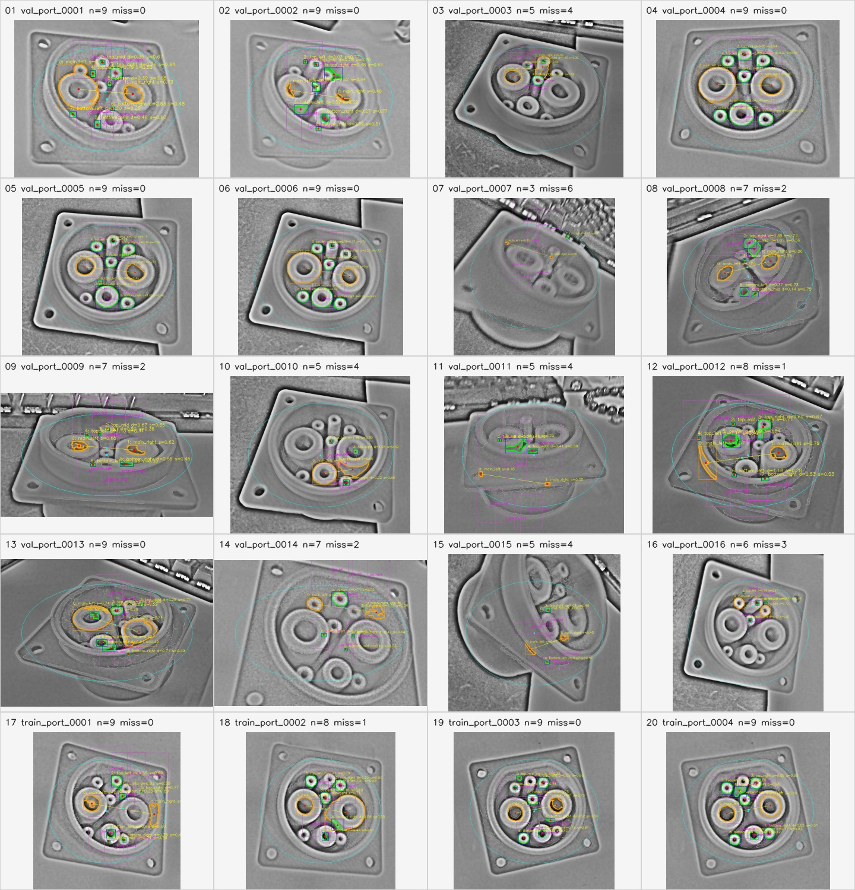
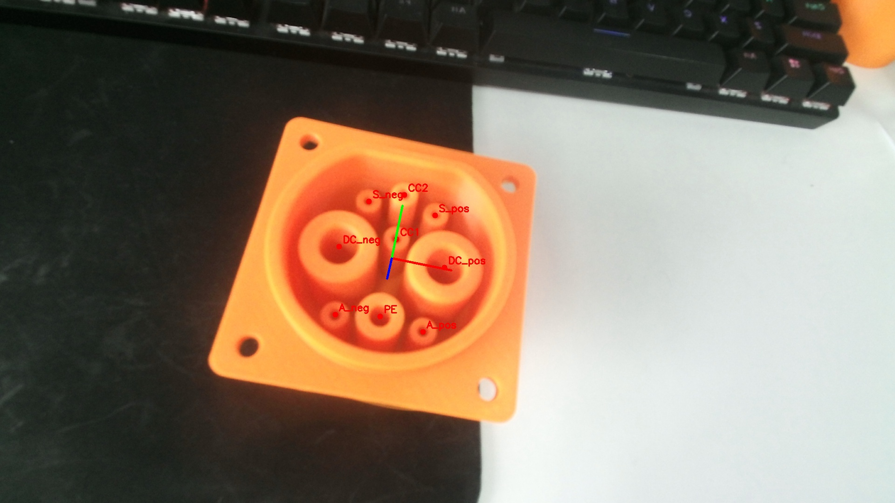
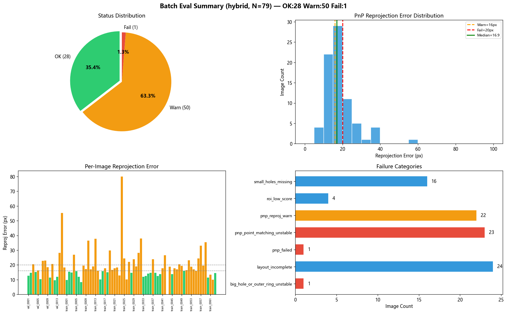

# robot-ev-charging

已增加面向 **RM75 六维力版 + D435 眼在手 + Windows/Python** 的力觉–视觉插装程序：同帧视觉、手眼标定、六维力处理、工程风险、GRU 纠偏、协同动作约束、导纳控制、状态机、模拟、日志回放及 A–F 实验工具。

完整使用说明见 [控制与实验运行说明](docs/control_usage.md)，D435 和手眼标定见 [视觉模块说明](vision/README.md)。当前代码与离线验证可运行；实际设备标定、载荷限值和真实力觉模型仍需实验验收，默认配置不会连接或驱动机器人。

2026-10-29 按打印件方案新增：分会话相机/几何误差诊断、RGB 内参独立图像检查、版本化孔口几何、有限试探与实际推进确认，以及 A/B/C/F 的 520 次任务编排。规则为 `finite-trial-v2`，旧 F 配置不能直接复用。软件与待采集项、4–6 周安排见 [打印件插装推进与验收](docs/printed_insertion_plan.md)；本次不代表已完成实物采集或真机插装实验。

当前检测器为 **YOLOv8n**，所有活动视觉入口从 `config/vision_model.json` 读取同一份模型记录。孔名关联继续使用人工复核 train 图学习的二维先验；算法与历次开发结果见 [人工复核后的视觉改进（历史记录）](docs/supervised_vision_improvement.md)。

D415 采训练数据、D435 用于机械臂定位的流程见 [D415 数据采集说明](docs/d415_data_collection.md)：独立采集原图和相机参数，按拍摄批次分组，再生成九孔人工复核页面。

## D415 快速使用（Windows / PowerShell）

### 1. 进入工程并准备环境

当前电脑已配置好 `.venv`，直接进入项目目录即可；其他电脑请替换为实际克隆目录：

```powershell
Set-Location "C:\Users\admin\Desktop\doc\毕业设计\robot-ev-charging"
```

**不需要激活虚拟环境。** 本机开启了 Windows 智能应用控制（Smart App Control），它在 Authenticode 层面拦截未签名的 `.ps1`，所以 `.venv\Scripts\Activate.ps1` 会报“未对文件进行数字签名”，`Set-ExecutionPolicy -Scope Process RemoteSigned` 也压不住（只有 `Bypass` 能绕过）。不需要为此关闭系统防护——所有命令直接用 `.venv\Scripts\python.exe` 全路径即可。确实想让 `python` 在会话里直接可用时，手工加 PATH，不执行任何脚本：

```powershell
$env:Path = "$PWD\.venv\Scripts;$env:Path"
```

相机入口还需要 `SeSecurityPrivilege`（librealsense 2.59.1 的全局互斥体带 SACL，缺失时报 `CreateNamedMutex returned Mutex_TotalFailure`）。**非管理员终端**请把下文的 `-m vision.preview` / `-m vision.collect` 换成 `-m vision.launch vision.preview` / `-m vision.launch vision.collect`，首次会弹一次 UAC；**管理员终端**保持原命令即可。原理与安全边界见 [Windows 权限说明](docs/windows_realsense_privilege.md)。

已验证环境为 **Windows + Python 3.12**。新电脑尚无 `.venv` 时，先安装 Python 3.12，再执行以下环境准备；已有环境不必重复创建：

```powershell
py -3.12 -m venv .venv
.\.venv\Scripts\python.exe -m pip install -r requirements-control.txt
```

本机 RTX 5080 的训练环境已切换为 `torch 2.14.1+cu132`、`torchvision 0.29.1+cu132`，实际 CUDA 前向/反向和 NMS 检查通过。Windows/Python 3.12 的 NVIDIA 电脑在装好上面的公共依赖后，再安装 GPU 包；该文件固定官方 wheel 及 SHA256：

```powershell
.\.venv\Scripts\python.exe -m pip install -r requirements-gpu.txt
.\.venv\Scripts\python.exe -c "import torch; print(torch.__version__, torch.cuda.is_available()); print(torch.cuda.get_device_name(0))"
```

本机 `.venv` 由 `uv` 创建，没有内置 pip；需要重新安装时可用 `uv pip install --python .venv/Scripts/python.exe -r requirements-gpu.txt`。训练默认 `--device 0`；GPU 不可用会明确报错，有意使用 CPU 时加 `--device cpu`。上述 GPU wheel 专用于 Windows 64 位/Python 3.12，其他平台应按 [PyTorch 官方安装说明](https://pytorch.org/get-started/locally/) 选择对应版本。

默认模型由 `config/vision_model.json` 统一指定。本次已验证的版本来自 `runs/detect_split_20261030T110042Z_105be6be/weights/best.pt`，之后的实际默认以该记录为准。D415 预览、D435 定位、Kinect 流水线、批量评估和图库预标注都使用这份记录；启动会核对权重文件与 SHA256，缺失或不符时明确报错。`runs/` 和 `*.pt` 被 Git 忽略，**新克隆不会包含模型权重**，换电脑需一并复制记录指向的文件。只用 `vision.collect` 采集原图不需要检测权重。

连接 D415，关闭占用它的 RealSense Viewer 或其他采集进程。查看设备型号和完整序列号：

```powershell
.\.venv\Scripts\python.exe -B -X utf8 -m vision.collect --list-devices
```

默认绑定本机 D415 `349222063070`。更换 D415 时，在下面的启动命令后加 `--serial 实际完整序列号`。D435 的机器人定位入口见 [视觉模块说明](vision/README.md)，不使用这里的 D415 预览入口。

### 2. 打开彩色与深度诊断

**非管理员终端**：本节及下文所有 `vision.preview` 命令都要加启动器前缀，写成 `-m vision.launch vision.preview ...`（首次弹一次 UAC）；管理员终端按原文执行。原因见上节与 [Windows 权限说明](docs/windows_realsense_privilege.md)。

```powershell
.\.venv\Scripts\python.exe -B -X utf8 -m vision.preview --depth
```

启动后打开两个窗口：

| 窗口 | 显示内容 |
| --- | --- |
| `D415 Visual Diagnostics` | 原始彩色画面、检测框、孔位候选、孔名、重投影点、逐孔残差及 mean/RMS/max |
| `D415 Depth Diagnostics` | 原生深度图、有效深度比例、双流时间差、目标区域距离、候选表面平面法向及 PnP 一致性 |

**2026-10-30 实拍示例**：新模型检出 1 个接口框，置信度 0.9453；9 个可见孔均有定位，孔名关联通过，PnP 内点为 9/9。该帧重投影平均 **1.561 px**、RMS **1.649 px**、最大 **2.441 px**，通过当前视觉质量检查。

[](docs/assets/readme/current_nine_hole_detection.png)

这是一帧的诊断结果，孔名依据配置模板，物理极性仍需与样件核对。SDK 内参与名义共面几何尚未独立验收，低重投影残差不代表毫米级精度或插装成功。此帧深度已读取，但候选平面因混合/非平面表面被拒绝；深度没有作为额外通道参与 YOLO 训练。

原图与诊断保存在 `artifacts/d415_preview/20261030T113406Z_08daa1e7cb41483aa29c681ddc53910a/`。历次微调和旧图对照保留在 [黑色打印件实验记录](docs/black_connector_finetune.md)。

USB3 预览默认彩色 **1920×1080 / 30 fps**，深度 **640×480 / Z16 / 30 fps**。加 `--quality hd` 使用 **1280×720 / 30 fps**。每次从实际流读取并保存对应内参；启动失败不会自动更换分辨率。

黑色打印件推荐这样启动，`--zoom` 放大唯一检测目标以观察孔口：

```powershell
.\.venv\Scripts\python.exe -B -X utf8 -m vision.preview --depth --zoom
```

窗口分别显示实测采集 FPS、分析 FPS 和帧年龄。采集线程持续取最新完整帧，分析线程保持图像、检测框、孔位和深度一致；30 fps 是请求的采集速率，不等于完整分析速率。曝光、档位及参数记录详见 [USB3 清晰度和曝光调节](docs/d415_data_collection.md#usb3-清晰度和曝光调节)。

只看彩色视觉、暂不开深度：

```powershell
.\.venv\Scripts\python.exe -B -X utf8 -m vision.preview
```

快速检查双流、自动保存第一组分析结果并在分析三帧后退出：

```powershell
.\.venv\Scripts\python.exe -B -X utf8 -m vision.preview --depth --frames 3 --save-first
```

### 3. 暂停、保存和退出

点击任一诊断窗口后操作；中文输入法下优先使用功能键：

| 按键 | 操作 |
| --- | --- |
| **F5** | 保存当前已分析帧的 RGB 原图、叠加图和诊断 JSON；深度模式同时保存该帧配对的原始深度 |
| **F6** | 暂停/继续两个窗口的显示；暂停时后台继续读取相机，保存仍对应冻结画面 |
| **Esc** | 结束会话、完成清单并释放相机；关闭任一诊断窗口也会退出 |
| **Z** | 完整画面 / 检测目标局部放大；原始 RGB 保持完整分辨率保存 |
| **A** | 切换 RGB 自动/手动曝光 |
| **[ / ]** | 减少/增加曝光，切换到手动曝光 |
| **- / =** | 减少/增加增益，切换到手动曝光 |

首次分析完成前按 F5 会提示等待。相同帧重复保存会跳过；没有检测到目标、孔位关联失败或 PnP 失败的画面也能保存，便于排查。字母和符号快捷键使用英文输入状态，还支持空格/S 保存、P 暂停、Q 退出。暂停时先按 F6 恢复再调整曝光；本次改变的 RGB 参数在退出时恢复。调高曝光可能增加运动拖影，调高增益可能增加噪声，以实际孔口细节为准。

采集打印件时可加批次、样件和拍摄说明；以下编号仅为填写示例，应替换为实际编号：

```powershell
.\.venv\Scripts\python.exe -B -X utf8 -m vision.preview --depth --batch d415_session01 --specimen print_dev01 --printing-batch print_batch01 --notes "打印件，正视，室内光照"
```

### 4. 保存位置和文件用途

每次启动在 `artifacts/d415_preview/` 下新建唯一会话目录，终端会打印完整路径：

```text
artifacts/d415_preview/<UTC时间_唯一标识>/
├─ camera.json                # 实际彩色流内参、畸变和设备身份
├─ depth_camera.json          # 深度模式：深度内参、尺度、深度到彩色外参
├─ manifest.json              # RGB 采集清单，可接入九孔人工复核
├─ preview_manifest.json      # 模型、配置、几何、代码及样本来源与哈希
├─ images/frame_000001.png    # 无叠加的 RGB 原图
├─ depth/frame_000001.png     # 深度模式且有原帧：原始 uint16 Z16
├─ overlays/frame_000001.png  # RGB 诊断叠加图
└─ diagnostics/frame_000001.json  # 同帧视觉和深度结果、残差、失败原因
```

深度 PNG 保留原值，**米值 = 像素值 × `depth_camera.json` 中的 `depth_scale_m`**；不能将其作为普通 8 位灰度图读取。深度彩图只用于显示，原始深度未对齐、未补洞。深度缺失时仍可保存 RGB 与失败原因，不生成假的深度文件。

预览数据默认 `split=unknown`，自动孔位不是人工真值。会话结束后，按 [九孔复核流程](docs/d415_data_collection.md#接入九孔复核) 使用其 `manifest.json` 生成复核页。采集图片、权重及 `artifacts/` 不会随 Git 提交。

### 5. 配置与结果判断

| 参数 | 默认配置 | 用途 |
| --- | --- | --- |
| `--capture-config` | `config/d415_preview_usb3.json` | D415 身份、彩色分辨率、帧率、预热与 RGB 选项 |
| `--depth-config` | `config/d415_depth_usb3.json` | 深度流与配对时间差阈值；仅在 `--depth` 时生效 |
| `--quality` | 遵循采集配置 | `full-hd` 显式选择 1080p/30，`hd` 选择 720p/30 |
| `--vision-config` | `config/d415_preview.json` | D415 检测/PnP 参数；通过 `config/vision_model.json` 读取当前模型 |
| `--geometry` | `config/geometry_nominal.json` | 孔位几何；使用实测几何时需匹配 `--specimen` 和 `--printing-batch` |
| `--output-root` | `artifacts/d415_preview` | 自定义会话根目录，必须在项目目录内 |

诊断可先使用实时读取的 SDK 内参，不要求先拍标定板；SDK 内参和名义几何仍标为未独立验证。**预览结果用于分析，不驱动机械臂。**

- “暂无位姿”或 `target_not_detected` 表示当前视觉没有得到可用目标位姿，深度正常也不会自动补出九孔。
- 深度黑色区域表示无效测量；有效比例只统计原生深度非零像素，不代表精度。未检测到充电口时只显示场景深度，目标距离和法向显示 `--`。
- 候选平面来自检测 ROI 内的表面点；不同台阶或孔底不一定属于建模孔口平面。它不能直接证明 PnP 位姿正确，也不直接修正重投影残差。
- 拍显示屏只能测到屏幕实际表面的深度，不能获得屏幕里 CAD 模型的三维深度；验证目标平面应使用实体打印件。
- 权重缺失或哈希不符：检查共享模型记录及其文件，不会回退到旧模型；型号/序列号不匹配：重新列设备；无法启动指定流：检查占用和配置。具体错误会打印在终端，已建立会话时也会记录失败状态。

D415 双窗口、暂停、同帧保存及退出已有实测记录；打印件目标平面和真实插装效果仍待实验。各阶段测试范围见 [实现与验证记录](docs/implementation_validation.md)，采集、深度指标和复核说明见 [D415 数据采集说明](docs/d415_data_collection.md)。

### 6. 只采 RGB 训练图片

不运行检测/PnP、只采集原图时使用：

```powershell
.\.venv\Scripts\python.exe -B -X utf8 -m vision.collect --batch d415_session01 --split unknown --notes "打印件，多角度"
```

这个入口使用**空格/S 保存、Q/Esc 退出**，输出在 `artifacts/captures/`；F5/F6 和深度功能属于上面的 `vision.preview`。原图与参数的划分、复核和训练衔接见 [采集说明](docs/d415_data_collection.md)。

## 离线演示与控制文档

快速运行离线演示（在项目根目录）：

```powershell
.venv\Scripts\python.exe -m control.simulate --scenario nominal
.venv\Scripts\python.exe -m unittest discover -s tests -v
```

新控制程序消费 `dataset/live/latest_control_pose.json`。实际 RM75/D435 的配置、标定和运行步骤见 [控制与实验运行说明](docs/control_usage.md)；D415 预览不写入该控制文件。

## Kinect 历史流程（旧设备参考）

以下保留 Kinect 设备专用流程，Python 命令统一使用项目 `.venv`，设备采集需要 Kinect SDK，并使用独立的历史近似内参。检测模型默认也读取 `config/vision_model.json`，相机参数仍属于 Kinect。当前 D415 请按上方快速使用章节操作。

电动汽车充电口视觉检测与位姿估计项目。项目覆盖数据集整理、YOLO 充电口检测、ROI 后处理、孔位中心提取，以及面向机器人充电实验的 PnP 位姿估计。

## 效果概览

### YOLO 与 ROI 裁剪



实时 RGB 图像先经过 YOLO 检测充电口。绿色框是检测框，黄色框是加入 padding 后的 ROI，后续边缘和孔位检测都基于这个 ROI。

### 边缘提取



ROI 经过自适应增强后生成边缘图。当前边缘阶段使用自适应阈值和结构区域掩膜，尽量保留充电口内部孔位边缘，同时抑制外部背景边缘。

### 孔位候选点



轮廓会经过几何特征、重复中心距离和标准孔位布局先验筛选。最终保留的候选点会进一步做椭圆拟合，输出孔位中心。



### PnP 位姿结果



ROI 内的孔位中心会先映射回原始 1920x1080 图像坐标，再结合 RGB 相机内参和 3D 模型点求解 PnP 位姿。

## 项目结构

```text
robot-ev-charging/
├─ config/
│  ├─ camera_intrinsics.json
│  ├─ charging_port_model.csv
│  ├─ live_pipeline_config.json
│  ├─ vision_model.json       # 所有活动视觉入口共用的当前权重与哈希
│  ├─ d415_preview.json      # D415 预览算法参数
│  └─ train_config.json
├─ train/
│  ├─ python/
│  │  ├─ convert_labelme_to_yolo_detect.py
│  │  ├─ check_yolo_dataset.py
│  │  └─ train_port.py
│  └─ cpp/
├─ live/
│  ├─ cpp/
│  │  ├─ kinect_live_capture_atomic.cpp
│  │  └─ read_kinect_intrinsics.cpp
│  └─ python/
│     ├─ launch_pipeline.py
│     ├─ roi.py
│     ├─ enhance.py
│     ├─ Canny.py
│     ├─ latest_candidate_contours.py
│     ├─ candidate_types.py
│     ├─ layout_prior.py
│     ├─ center_fit.py
│     ├─ pnp2.py
│     ├─ pipeline_quality.py
│     └─ post_vis_watch.py
├─ dataset/vision/     # 按日期保存的统一图库、标签及来源记录，Git 忽略
│  └─ source_annotations/ # 已迁移的历史原始标注
├─ dataset/live/        # 运行时输入输出，Git 忽略
├─ docs/
└─ runs/                # YOLO 训练输出，Git 忽略
```

## Kinect 设备前提

Python 使用上方已配置的 Windows/Python 3.12 `.venv`。Kinect 实时采集另外需要 Microsoft Kinect SDK v2 和本机编译的 C++ 采集程序；仅运行已保存图片的批量评估不需要连接 Kinect。

## 数据集与训练

### 统一图库、固定划分与 GPU 训练（当前入口）

所有充电接口原始 RGB 统一放在 `dataset/vision/`，按日期整理。旧 `yolo_port` 已迁移移除，采集会话中的原图、深度和相机参数保留。日期只用于整理，**每轮训练使用完整 train 集，每次验证使用完整 val 集，两者合起来覆盖全部可用图片**。完全相同的文件按 SHA256 合并为一张，所有原始路径保存在来源记录中；检测叠加图、深度彩图、训练拼图和裁剪副本不重复当作原图。

2026-10-30 本轮训练快照使用 **233 张可训练接口图，7 条永久排除记录**。首次汇总为 245 份来源文件→240 张唯一 RGB；用户随后明确保留删除 10 月 28、29 日的副本，永久排除其中 6 张桌面图及 1 张显示屏模型图。同步不会恢复这些已排除副本。`yolo_port` 的 63 张 train＋16 张 val 全部纳入来源清单，精确重复合并后保留 74 张历史原图。已补齐新接口图标注并解决 5 组同图异框；新框由助手目视检查，`human_reviewed=false`，可继续人工修订。此后新采集的图片先进入待标注状态，不计入这次训练成绩。

固定划分在 `config/port_dataset_split.json`：**197 张 train、36 张 val（84.5% / 15.5%）**。相邻 03:13–03:15 三个会话的 139 张保持同一组；另外三个采集组整体进入 val。历史 74 张没有可靠会话记录，保留原有 58/16 分组，因此 val 是**开发验证集，不宣称严格独立测试集**。新训练从通用 COCO 预训练 `yolov8n.pt` 开始，不使用已经见过这些验证图的项目微调权重。

2026-10-30 已在 **RTX 5080** 完成这组划分的 40 轮训练，输出为 `runs/detect_split_20261030T110042Z_105be6be/`。40 轮均为 197/197 主样本覆盖，共 7,880 次；40 轮验证及最终 best 验证均为 36/36。最佳权重的开发验证指标：Precision **0.97011**、Recall **0.97222**、mAP50 **0.97111**、mAP50–95 **0.91302**。这是目标框检测结果，不是九孔或插装精度；历史会话不明及助手框未经用户复核的限制仍然存在。数据/标签/权重哈希与覆盖核验见同目录 `post_training_audit.json`；本轮完整软件测试 484 项通过。

历史同池 CPU 训练保留在 `runs/detect_all_20261030T095259Z_1c28e535/`：40 轮、234/234 主样本覆盖通过，包含后来排除的屏幕模型图；其 `val=train` 指标仅是训练回看，与现在的固定划分结果不能直接对比。

```text
dataset/vision/
├─ images/2026-10-30/   # 原始 RGB 副本；无日期的旧图在 historical/
├─ labels/2026-10-30/   # 对应 YOLO 框；类别 0 = port
├─ records/             # 每图 SHA256、来源、标注状态、冲突历史、排除原因
├─ source_annotations/  # 历史51份Labelme JSON、79份YOLO标签及1份YAML原件
└─ sync_report.json     # 最近同步数量与状态
```

下列命令均在仓库根目录运行，使用已有 `.venv`。图库、采集数据和训练权重被 Git 忽略；换电脑需要另外复制。缺少初始权重时用 `--weights` 指定本地 YOLOv8n `.pt`，训练入口不会自动下载。

**1. 采集与汇总。** `vision.preview`（含 `--depth`）和 `vision.collect` 每次保存时自动入库。只有原始 RGB 入库，深度继续留在采集会话；新图状态为 `pending`，不会把漏检自动当作背景。可用 `--library <目录>` 指定图库；专门的诊断会话可用 `--no-library`，该设置会被后续同步尊重。

```powershell
.\.venv\Scripts\python.exe -B -X utf8 -m vision.preview --depth
.\.venv\Scripts\python.exe -B -X utf8 train/python/prepare_port_library.py
.\.venv\Scripts\python.exe -B -X utf8 -m vision.training_library status
```

同步会检查已迁移来源、已有 v2 复核标签，以及 `artifacts/captures`、`d415_preview`、`d415_sdk_apply`、`d415_live_check`、`d415_usb3_recheck`、`d415_preview_upgrade` 下的原始 RGB。旧文件名通过 `config/legacy_photo_index.json` 映射到统一图库，删除旧目录后仍可追溯。其他位置的充电接口原图通过 `--source "原图文件夹"` 导入。自定义采集输出目录发生入库失败时，同样用 `--source` 补录；不要把深度或叠加图目录作为原图来源。

**2. 给新增图片补标注。** 以下命令生成可编辑复核页；预标框不会直接写成有效标签。打开页面，在图上拖动添加框，或编辑下方归一化 YOLO 坐标，逐张点击“确认框并下一张”；无接口图点击“无接口，排除”。导出前不要关闭页面，未导出的编辑仅保留在当前页面中。

```powershell
.\.venv\Scripts\python.exe -B -X utf8 train/python/prepare_port_library.py --review artifacts/port_library_review.html
Start-Process artifacts/port_library_review.html
# 在页面导出 reviewed_port_boxes.json 后，按实际下载路径导入：
.\.venv\Scripts\python.exe -B -X utf8 -m vision.training_library annotate --review-json "$env:USERPROFILE\Downloads\reviewed_port_boxes.json"
```

预标注默认使用 `config/vision_model.json` 中的当前模型；加 `--no-suggestions` 可直接手动画框，`--weights 本地文件.pt` 可显式选择其他权重。需要重新检查全部已有标签时加 `--all`；已删除副本的永久排除记录不会生成空白图片页。不要直接改库内标签文件；通过复核页导入才能同步标签哈希和修改历史。页面标的是目标框，九孔身份与中心仍使用独立的九孔标注流程。

**3. 给新会话指定集合。** 已登记组内的新图继承原集合；未知组不会被静默分配。补完标注后，先查看待分组项，再复制输出中的实际 `group_id` 分配到 train 或 val。相邻或重叠的采集应属于同一组；已固定组不能用此命令随意换集合。

```powershell
.\.venv\Scripts\python.exe -B -X utf8 -m train.python.dataset_split --list-pending
# 将实际group_id替换成上一步输出的完整值：
.\.venv\Scripts\python.exe -B -X utf8 -m train.python.dataset_split --assign-group "实际group_id" --split train
```

**4. 使用完整固定划分训练 YOLOv8n。** 当前默认通用 `yolov8n.pt`、GPU 0、640 输入、batch 16、40 轮；全部 train 图每轮参与采样，val 只参与开发验证。初始权重校验为本项目登记的通用预训练文件，不把已训练过验证图片的微调权重误当作通用权重。

```powershell
# 可先只检查并生成完整冻结快照，不启动训练：
.\.venv\Scripts\python.exe -B -X utf8 train/python/train_port.py --prepare-only
# 正式全量训练（另建一次独立快照和输出目录）：
.\.venv\Scripts\python.exe -B -X utf8 train/python/train_port.py
# 明确指定GPU、轮数和batch；不恢复旧微调权重：
.\.venv\Scripts\python.exe -B -X utf8 train/python/train_port.py --epochs 40 --batch 16 --device 0
```

启动前自动同步并检查全库；有待标注、未分组、冲突、损坏、哈希不符或未登记图片时会报错，**不会静默跳过后宣称全部覆盖**。每次新建独立的训练目录，复制冻结原图、标签、划分及初始权重；快照中有独立的 `dataset/images/train`、`dataset/images/val` 和配套 labels。检查实际加载的图片与框、集合无重叠、train＋val 覆盖全部 ready 图。`epoch_coverage.jsonl` 要求每张 train 图每轮恰好作为主样本采样一次，尾批保留；另核验完整 val 覆盖。Mosaic 额外拼接图片不计入主样本次数，随机增强可能裁掉部分目标。训练开始后新增照片进入下一次快照。

输出目录包含 `training_manifest.json`（图片和来源）、`training_report.json`（完成状态和参数）、`epoch_coverage.jsonl`、`validation_coverage.jsonl`、`weights/best.pt`、`weights/last.pt`。全部指定轮数、覆盖和权重检查成功后，训练入口才原子更新 `config/vision_model.json`；失败或中断不会替换当前模型。重新启动各视觉进程后使用更新后的模型，已经运行的窗口继续使用启动时加载的模型。

日常预览仍使用同一条短命令；每轮独立保存的 `preview_config.json` 固定当轮权重，供历史实验回放：

```powershell
# 日常使用当前模型：
.\.venv\Scripts\python.exe -B -X utf8 -m vision.preview --depth
# 只在复现特定训练轮次时，替换为实际 detect_split_... 目录名：
.\.venv\Scripts\python.exe -B -X utf8 -m vision.preview --depth --vision-config "runs/本轮目录/preview_config.json"
```

现在的 36 张 val 不进入本轮优化器训练，但会用于选模，不能称为最终独立测试成绩。YOLO 仍只使用 RGB 和目标框，深度没有作为额外通道输入。最终泛化评价需要另拍独立样件/会话并冻结为 test，不参与训练或选模。

### 历史图片迁移记录

旧目录的 79 份图片逐一核对 SHA256 后迁入统一图库（74 张唯一图），131 份原始标注/配置完整归档。迁移映射保存在 `config/legacy_photo_index.json`，本地核验报告在 `dataset/vision/legacy_migration_report.json`。历史报告中的 `yolo_port/...` 是来源身份，活动入口通过映射找到当前原图，不再创建旧目录。统一库检查命令：

```powershell
.\.venv\Scripts\python.exe -B -X utf8 train/python/check_yolo_dataset.py
```

## Kinect 历史实时流水线

启动完整实时流水线：

```powershell
.\.venv\Scripts\python.exe -B -X utf8 live\python\launch_pipeline.py
```

流水线配置文件：

```text
config/live_pipeline_config.json
```

主要步骤：

1. `roi.py`
   检测充电口并裁剪带 padding 的 ROI。
2. `enhance.py`
   对 ROI 做自适应 gamma、光照归一化、受控 CLAHE、保边降噪和局部锐化。
3. `Canny.py`
   生成边缘图。`VISION_EDGE_METHOD` 可设置为 `canny`、`morph` 或 `hybrid`。
4. `latest_candidate_contours.py`
   筛选轮廓，应用孔位布局先验，拟合中心并导出中心数据。
5. `pnp2.py`
   将 ROI 坐标映射回原图坐标，并求解 PnP 位姿。
6. `pipeline_quality.py`
   输出 ROI、边缘、候选点和 PnP 的质量报告。

## 运行时输出

运行时文件写入 `dataset/live/`，该目录不会提交到 Git：

```text
latest.jpg                       # 采集到的 RGB 原图
latest_vis.jpg                   # YOLO/ROI 可视化
latest_roi.jpg                   # 裁剪后的 ROI
latest_roi_meta.json             # ROI 元数据和原图偏移
latest_roi_enhanced.jpg          # 增强后的 ROI
latest_roi_enhance_metrics.json  # 增强统计指标
latest_edges.jpg                 # 边缘图
latest_edges_vis.jpg             # 边缘叠加图
latest_candidate_contours.jpg    # 轮廓和布局可视化
latest_fitted_centers.jpg        # 拟合中心可视化
latest_fitted_centers.json       # 拟合中心数据
latest_pose.json                 # PnP 位姿结果
latest_pose_vis.jpg              # PnP 可视化
latest_pipeline_quality.json     # 流水线质量报告
```

## 质量报告

流水线产生输出后，可以运行：

```powershell
.\.venv\Scripts\python.exe -B -X utf8 live\python\pipeline_quality.py
```

质量报告会检查：

- ROI 检测分数和裁剪尺寸
- 边缘密度
- 候选点数量、布局距离和拟合中心漂移
- PnP 重投影误差和相机内参状态

历史 79 张样张（hybrid 边缘模式）的旧版评估记录如下，不代表当前模型结果，也不能与迁移后去重的 74 张直接比较：

```text
OK: 29 (36.7%)   Warn: 49   Fail: 1
中位数重投影: 17.0 px
主要问题: layout_incomplete(24), pnp_point_matching_unstable(23)
```

## 批量评估

不要只用单张样例调参数。可以用批量评估脚本一次性跑 20-50 张原图，统计每张图的 ROI、边缘、候选孔位、布局完整性和 PnP 误差：

```powershell
.\.venv\Scripts\python.exe -B -X utf8 live\python\batch_pipeline_eval.py --max-images 50
```

推荐使用 hybrid 边缘模式以获得更好的小孔召回率：

```powershell
$env:VISION_EDGE_METHOD='hybrid'
.\.venv\Scripts\python.exe -B -X utf8 live\python\batch_pipeline_eval.py --max-images 50
```

默认输入目录为迁移后的历史 Kinect 图片；本入口仍使用历史固定内参，不要混入 D415/D435 图片评价重投影误差。新相机图像使用采集会话中记录的内参与对应诊断入口。

```text
dataset/vision/images/historical
```

也可以指定自己的图片目录：

```powershell
.\.venv\Scripts\python.exe -B -X utf8 live\python\batch_pipeline_eval.py --image-dir path\to\images --max-images 30
```



输出目录：

```text
artifacts/batch_eval/YYYYMMDD_HHMMSS/
├─ summary.csv
├─ failures.csv
└─ details.json
```

评估指标包括：

- 检出几个孔位候选
- 是否 9 个布局点齐全
- 缺失哪些 layout 点
- PnP 重投影误差
- PnP 内点数量
- 失败样例分类

当前失败分类包括：

- `roi_missing`：YOLO 没检出 ROI
- `roi_low_score`：ROI 检测置信度偏低
- `roi_suspicious_size`：ROI 尺寸比例异常
- `canny_too_sparse`：边缘过少
- `canny_too_noisy`：边缘过密
- `layout_incomplete`：9 点布局不完整
- `small_holes_missing`：小孔缺失
- `big_hole_or_outer_ring_unstable`：大孔或外圈粘连导致主孔不稳
- `pnp_failed`：PnP 无法求解
- `pnp_reproj_warn`：PnP 重投影误差偏高
- `pnp_point_matching_unstable`：PnP 点位匹配明显不稳

如果希望有失败样例时让命令返回非零退出码，可加：

```powershell
.\.venv\Scripts\python.exe -B -X utf8 live\python\batch_pipeline_eval.py --strict-exit
```

## 相机内参

`config/camera_intrinsics.json` 当前使用 Kim et al. (2016) 的 Kinect v2 RGB 相机 1920x1080 标定值：

```text
fx = 1053.62, fy = 1047.51
cx = 950.39,  cy = 527.34
dist = [0.0042, -0.0019, -0.0038, -0.0026, 0.0]
```

来源：Kim et al. "Color and Depth Image Correspondence for Kinect v2", Springer LNEE vol.354。畸变模型为 OpenCV 标准 plumb_bob 5 参数模型。

这个配置仍标记为近似值，每台 Kinect v2 出厂参数略有差异。要获得可靠的绝对位姿，后续应替换为当前设备的实际棋盘格标定结果。

注意：PnP 使用的是原图坐标。ROI 内检测到的中心点会先映射回 1920x1080 原图坐标，再参与 PnP，因此 `camera_intrinsics.json` 必须对应原始 RGB 图像，而不是裁剪后的 ROI。

## Kinect 内参工具

`live/cpp/read_kinect_intrinsics.cpp` 可以通过 Microsoft Kinect SDK v2 读取 Kinect v2 深度相机内参：

```powershell
live\cpp\read_kinect_intrinsics.exe
```

深度相机内参不是 RGB 相机内参。当前 PnP 使用 RGB 图像点，所以不能把深度内参直接复制到 `camera_intrinsics.json`。

## 深度测试工具

`live/cpp/kinect_depth_probe.cpp` 是一个独立的深度链路冒烟测试工具，不改变当前 RGB/PnP 主流程。

```powershell
live\cpp\kinect_depth_probe.exe
```

如果 Kinect v2 已连接，工具会等待一帧深度图，并写入：

```text
dataset/live/latest_depth_status.json
```

报告中包含深度图尺寸、有效深度点数量、有效比例，以及深度的最小值、平均值和最大值，单位为毫米。如果未连接相机，工具会正常退出并写入 `status: no_frame`，因此可以安全用于离线测试。

## 常用命令

单独运行候选点提取和 PnP，且不阻塞 OpenCV 窗口：

```powershell
$env:VISION_PIPELINE_MODE='1'
.\.venv\Scripts\python.exe -B -X utf8 live\python\latest_candidate_contours.py
.\.venv\Scripts\python.exe -B -X utf8 live\python\pnp2.py
```

调试时手动保持窗口打开：

```powershell
$env:VISION_WAIT_FOR_KEY='1'
.\.venv\Scripts\python.exe -B -X utf8 live\python\pnp2.py
```

语法检查：

```powershell
.\.venv\Scripts\python.exe -m py_compile live\python\latest_candidate_contours.py live\python\layout_prior.py live\python\center_fit.py live\python\pnp2.py
```

## 已知限制

- RGB 相机内参仍需要替换为当前设备的真实标定结果。
- 当前验证主要基于已有 live 样张，新光照和新视角还需要继续测试。
- Kinect v2 深度数据适合作为距离校验或安全检查，目前不作为孔位中心检测的主输入。
- 部分历史源码注释仍有编码乱码，后续可以继续清理。

## Git 忽略策略

以下内容不提交：

- `dataset/live/`
- `artifacts/`
- `runs/`
- `*.pt`
- Python cache 和 YOLO cache
- C/C++ 编译产物，例如 `*.exe`、`*.obj`、`*.pdb`、`*.ilk`
