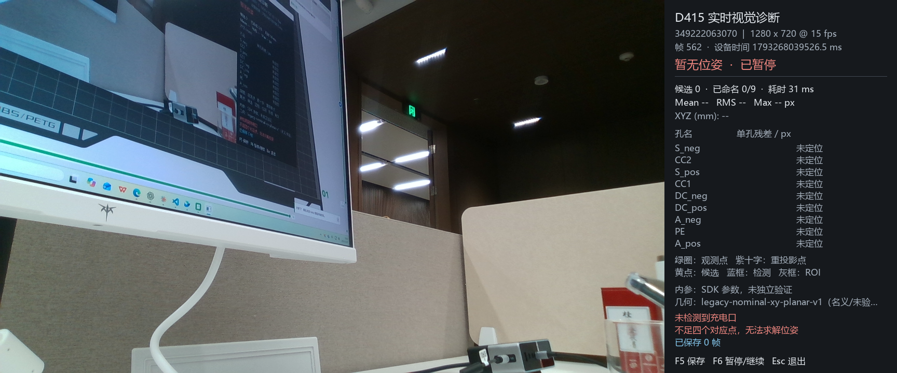
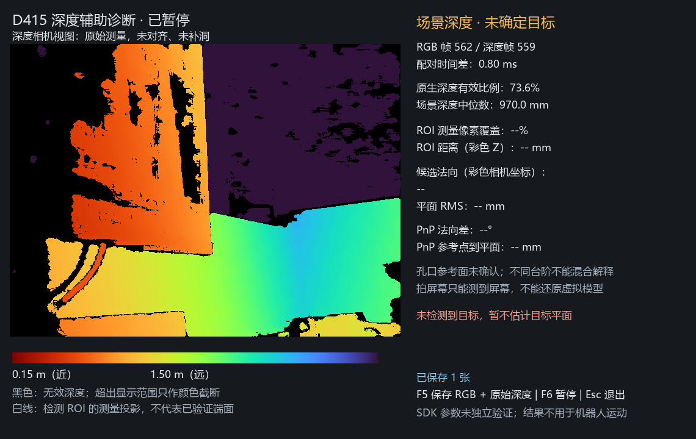

# robot-ev-charging

已增加面向 **RM75 六维力版 + D435 眼在手 + Windows/Python** 的力觉–视觉插装程序：同帧视觉、手眼标定、六维力处理、工程风险、GRU 纠偏、协同动作约束、导纳控制、状态机、模拟、日志回放及 A–F 实验工具。

完整使用说明见 [控制与实验运行说明](docs/control_usage.md)，D435 和手眼标定见 [视觉模块说明](vision/README.md)。当前代码与离线验证可运行；实际设备标定、载荷限值和真实力觉模型仍需实验验收，默认配置不会连接或驱动机器人。

2026-10-29 按打印件方案新增：分会话相机/几何误差诊断、RGB 内参独立图像检查、版本化孔口几何、有限试探与实际推进确认，以及 A/B/C/F 的 520 次任务编排。规则为 `finite-trial-v2`，旧 F 配置不能直接复用。软件与待采集项、4–6 周安排见 [打印件插装推进与验收](docs/printed_insertion_plan.md)；本次不代表已完成实物采集或真机插装实验。

2026-10-27 已根据 24 张人工复核图更新视觉默认配置：修正 3 个训练框、重训检测器，并引入仅由 train 标注学习的二维孔位关联。190 个可见参考点中，返回正确点 106→118、错点 48→0、缺失 36→72；改善主要在减少误认，漏点仍需继续处理。结果、默认运行命令及数据边界见 [人工复核后的视觉改进](docs/supervised_vision_improvement.md)。

D415 采训练数据、D435 用于机械臂定位的流程见 [D415 数据采集说明](docs/d415_data_collection.md)：独立采集原图和相机参数，按拍摄批次分组，再生成九孔人工复核页面。

## D415 快速使用（Windows / PowerShell）

### 1. 进入工程并准备环境

当前电脑已配置好 `.venv`，直接进入项目目录即可；其他电脑请替换为实际克隆目录：

```powershell
Set-Location "C:\Users\admin\Desktop\doc\毕业设计\robot-ev-charging"
```

已验证环境为 **Windows + Python 3.12**。新电脑尚无 `.venv` 时，先安装 Python 3.12，再执行以下环境准备；已有环境不必重复创建：

```powershell
py -3.12 -m venv .venv
.\.venv\Scripts\python.exe -m pip install -r requirements-control.txt
```

实时检测默认读取 `runs/detect_reviewed/weights/best.pt`。本机已有该权重，但 `runs/` 和 `*.pt` 被 Git 忽略，**新克隆不会包含模型权重**：需要另行放入训练好的权重，或通过 `--vision-config` 指定 JSON 并设置其中的 `weights` 路径。只用 `vision.collect` 采集原图不需要检测权重。

连接 D415，关闭占用它的 RealSense Viewer 或其他采集进程。查看设备型号和完整序列号：

```powershell
.\.venv\Scripts\python.exe -B -X utf8 -m vision.collect --list-devices
```

默认绑定本机 D415 `349222063070`。更换 D415 时，在下面的启动命令后加 `--serial 实际完整序列号`。D435 的机器人定位入口见 [视觉模块说明](vision/README.md)，不使用这里的 D415 预览入口。

### 2. 打开彩色与深度诊断

```powershell
.\.venv\Scripts\python.exe -B -X utf8 -m vision.preview --depth
```

启动后打开两个窗口：

| 窗口 | 显示内容 |
| --- | --- |
| `D415 Visual Diagnostics` | 原始彩色画面、检测框、孔位候选、孔名、重投影点、逐孔残差及 mean/RMS/max |
| `D415 Depth Diagnostics` | 原生深度图、有效深度比例、双流时间差、目标区域距离、候选表面平面法向及 PnP 一致性 |

**彩色诊断示例**：暂停画面右侧显示帧信息、九孔状态与失败原因。此帧未检测到充电口，因此位姿和重投影残差显示 `--`。点击图片可查看原尺寸。

[](docs/assets/readme/d415_rgb_preview.png)

**同组数据的深度诊断示例**：黑色区域为无效深度，右侧显示约 73.6% 的非零深度比例和约 0.80 ms 的双流时间差。未确定目标时仅显示场景深度，目标距离、法向和 PnP 一致性保持为空。

[](docs/assets/readme/d415_depth_preview.png)

两图来自 2026-10-29 的同组实拍数据（RGB 帧 562 / 深度帧 559），用于展示诊断界面，不代表打印件位姿或插装精度验证。彩色图是保存前绘制的叠加图；深度面板由保存后的同组数据重绘，因此保存计数分别为 0 和 1。

彩色流为 **1280×720 / 15 fps**，深度流为 **640×480 / Z16 / 15 fps**。2026-10-29 已在本机报告 USB 2.1 的连接上验证这组双流；程序不会在启动失败时自动更换分辨率。配置位置和指标定义见下文。

只看彩色视觉、暂不开深度：

```powershell
.\.venv\Scripts\python.exe -B -X utf8 -m vision.preview
```

快速检查双流、自动保存第一组分析结果并在分析三帧后退出：

```powershell
.\.venv\Scripts\python.exe -B -X utf8 -m vision.preview --depth --frames 3 --save-first
```

### 3. 暂停、保存和退出

点击任一诊断窗口后操作；中文输入法下优先使用功能键：

| 按键 | 操作 |
| --- | --- |
| **F5** | 保存当前已分析帧的 RGB 原图、叠加图和诊断 JSON；深度模式同时保存该帧配对的原始深度 |
| **F6** | 暂停/继续两个窗口的显示；暂停时后台继续读取相机，保存仍对应冻结画面 |
| **Esc** | 结束会话、完成清单并释放相机；关闭任一诊断窗口也会退出 |

首次分析完成前按 F5 会提示等待。相同帧重复保存会跳过；没有检测到目标、孔位关联失败或 PnP 失败的画面也能保存，便于排查。英文输入状态下还支持空格/S 保存、P 暂停、Q 退出。

采集打印件时可加批次、样件和拍摄说明；以下编号仅为填写示例，应替换为实际编号：

```powershell
.\.venv\Scripts\python.exe -B -X utf8 -m vision.preview --depth --batch d415_session01 --specimen print_dev01 --printing-batch print_batch01 --notes "打印件，正视，室内光照"
```

### 4. 保存位置和文件用途

每次启动在 `artifacts/d415_preview/` 下新建唯一会话目录，终端会打印完整路径：

```text
artifacts/d415_preview/<UTC时间_唯一标识>/
├─ camera.json                # 实际彩色流内参、畸变和设备身份
├─ depth_camera.json          # 深度模式：深度内参、尺度、深度到彩色外参
├─ manifest.json              # RGB 采集清单，可接入九孔人工复核
├─ preview_manifest.json      # 模型、配置、几何、代码及样本来源与哈希
├─ images/frame_000001.png    # 无叠加的 RGB 原图
├─ depth/frame_000001.png     # 深度模式且有原帧：原始 uint16 Z16
├─ overlays/frame_000001.png  # RGB 诊断叠加图
└─ diagnostics/frame_000001.json  # 同帧视觉和深度结果、残差、失败原因
```

深度 PNG 保留原值，**米值 = 像素值 × `depth_camera.json` 中的 `depth_scale_m`**；不能将其作为普通 8 位灰度图读取。深度彩图只用于显示，原始深度未对齐、未补洞。深度缺失时仍可保存 RGB 与失败原因，不生成假的深度文件。

预览数据默认 `split=unknown`，自动孔位不是人工真值。会话结束后，按 [九孔复核流程](docs/d415_data_collection.md#接入九孔复核) 使用其 `manifest.json` 生成复核页。采集图片、权重及 `artifacts/` 不会随 Git 提交。

### 5. 配置与结果判断

| 参数 | 默认配置 | 用途 |
| --- | --- | --- |
| `--capture-config` | `config/data_capture_d415.json` | D415 身份、彩色分辨率、帧率与预热 |
| `--depth-config` | `config/d415_depth_diagnostics.json` | 深度流与配对时间差阈值；仅在 `--depth` 时生效 |
| `--vision-config` | `config/realsense_config.json` | 预览仅使用检测/PnP 参数，不执行其中的 D435 采集或控制输出配置 |
| `--geometry` | `config/geometry_nominal.json` | 孔位几何；使用实测几何时需匹配 `--specimen` 和 `--printing-batch` |
| `--output-root` | `artifacts/d415_preview` | 自定义会话根目录，必须在项目目录内 |

诊断可先使用实时读取的 SDK 内参，不要求先拍标定板；SDK 内参和名义几何仍标为未独立验证。**预览结果用于分析，不驱动机械臂。**

- “暂无位姿”或 `target_not_detected` 表示当前视觉没有得到可用目标位姿，深度正常也不会自动补出九孔。
- 深度黑色区域表示无效测量；有效比例只统计原生深度非零像素，不代表精度。未检测到充电口时只显示场景深度，目标距离和法向显示 `--`。
- 候选平面来自检测 ROI 内的表面点；不同台阶或孔底不一定属于建模孔口平面。它不能直接证明 PnP 位姿正确，也不直接修正重投影残差。
- 拍显示屏只能测到屏幕实际表面的深度，不能获得屏幕里 CAD 模型的三维深度；验证目标平面应使用实体打印件。
- `YOLO weights missing`：检查权重路径；型号/序列号不匹配：重新列设备；无法启动指定流：检查占用和配置。具体错误会打印在终端，已建立会话时也会记录失败状态。

本次相关 112 项测试通过，D415 双窗口、暂停、同帧保存及退出已实测；打印件目标平面和真实插装效果仍待实验。验证范围见 [实现与验证记录](docs/implementation_validation.md)。更完整的采集、深度指标和复核说明见 [D415 数据采集说明](docs/d415_data_collection.md)。

### 6. 只采 RGB 训练图片

不运行检测/PnP、只采集原图时使用：

```powershell
.\.venv\Scripts\python.exe -B -X utf8 -m vision.collect --batch d415_session01 --split unknown --notes "打印件，多角度"
```

这个入口使用**空格/S 保存、Q/Esc 退出**，输出在 `artifacts/captures/`；F5/F6 和深度功能属于上面的 `vision.preview`。原图与参数的划分、复核和训练衔接见 [采集说明](docs/d415_data_collection.md)。

## 离线演示与控制文档

快速运行离线演示（在项目根目录）：

```powershell
.venv\Scripts\python.exe -m control.simulate --scenario nominal
.venv\Scripts\python.exe -m unittest discover -s tests -v
```

新控制程序消费 `dataset/live/latest_control_pose.json`。实际 RM75/D435 的配置、标定和运行步骤见 [控制与实验运行说明](docs/control_usage.md)；D415 预览不写入该控制文件。

## Kinect 历史流程（旧设备参考）

以下保留原 Kinect 视觉程序说明，使用 `.yolo_env`、Kinect SDK 和历史近似内参。当前 D415 请按上方快速使用章节操作。

电动汽车充电口视觉检测与位姿估计项目。项目覆盖数据集整理、YOLO 充电口检测、ROI 后处理、孔位中心提取，以及面向机器人充电实验的 PnP 位姿估计。

## 效果概览

### YOLO 与 ROI 裁剪


实时 RGB 图像先经过 YOLO 检测充电口。绿色框是检测框，黄色框是加入 padding 后的 ROI，后续边缘和孔位检测都基于这个 ROI。

### 边缘提取


ROI 经过自适应增强后生成边缘图。当前边缘阶段使用自适应阈值和结构区域掩膜，尽量保留充电口内部孔位边缘，同时抑制外部背景边缘。

### 孔位候选点


轮廓会经过几何特征、重复中心距离和标准孔位布局先验筛选。最终保留的候选点会进一步做椭圆拟合，输出孔位中心。


### PnP 位姿结果


ROI 内的孔位中心会先映射回原始 1920x1080 图像坐标，再结合 RGB 相机内参和 3D 模型点求解 PnP 位姿。

## 项目结构

```text
robot-ev-charging/
├─ config/
│  ├─ camera_intrinsics.json
│  ├─ charging_port_model.csv
│  ├─ live_pipeline_config.json
│  └─ train_config.json
├─ train/
│  ├─ python/
│  │  ├─ convert_labelme_to_yolo_detect.py
│  │  ├─ check_yolo_dataset.py
│  │  └─ train_port.py
│  └─ cpp/
├─ live/
│  ├─ cpp/
│  │  ├─ kinect_live_capture_atomic.cpp
│  │  └─ read_kinect_intrinsics.cpp
│  └─ python/
│     ├─ launch_pipeline.py
│     ├─ roi.py
│     ├─ enhance.py
│     ├─ Canny.py
│     ├─ latest_candidate_contours.py
│     ├─ candidate_types.py
│     ├─ layout_prior.py
│     ├─ center_fit.py
│     ├─ pnp2.py
│     ├─ pipeline_quality.py
│     └─ post_vis_watch.py
├─ yolo_port/
│  ├─ images/train, images/val
│  ├─ labels/train, labels/val
│  └─ dataset.yaml
├─ dataset/live/        # 运行时输入输出，Git 忽略
├─ docs/
└─ runs/                # YOLO 训练输出，Git 忽略
```

## Kinect 历史环境准备

推荐环境：Windows、Python 3.9+。如果需要实时采集，需要安装 Microsoft Kinect SDK v2。

```powershell
python -m venv .yolo_env
.yolo_env\Scripts\activate
pip install -r requirements.txt
```

主要 Python 依赖：

- `ultralytics`
- `torch`
- `opencv-python`
- `numpy`

## 数据集与训练

Labelme 图片和标注文件放在：

```text
yolo_port/images/train
yolo_port/images/val
```

将 Labelme 标注转换为 YOLO 标签：

```powershell
.yolo_env\Scripts\python.exe train\python\convert_labelme_to_yolo_detect.py
```

检查 YOLO 数据集：

```powershell
.yolo_env\Scripts\python.exe train\python\check_yolo_dataset.py
```

训练检测模型：

```powershell
.yolo_env\Scripts\python.exe train\python\train_port.py
```

默认权重输出位置：

```text
runs/detect_retrain/weights/best.pt
```

## Kinect 历史实时流水线

启动完整实时流水线：

```powershell
.yolo_env\Scripts\python.exe live\python\launch_pipeline.py
```

流水线配置文件：

```text
config/live_pipeline_config.json
```

主要步骤：

1. `roi.py`
   检测充电口并裁剪带 padding 的 ROI。
2. `enhance.py`
   对 ROI 做自适应 gamma、光照归一化、受控 CLAHE、保边降噪和局部锐化。
3. `Canny.py`
   生成边缘图。`VISION_EDGE_METHOD` 可设置为 `canny`、`morph` 或 `hybrid`。
4. `latest_candidate_contours.py`
   筛选轮廓，应用孔位布局先验，拟合中心并导出中心数据。
5. `pnp2.py`
   将 ROI 坐标映射回原图坐标，并求解 PnP 位姿。
6. `pipeline_quality.py`
   输出 ROI、边缘、候选点和 PnP 的质量报告。

## 运行时输出

运行时文件写入 `dataset/live/`，该目录不会提交到 Git：

```text
latest.jpg                       # 采集到的 RGB 原图
latest_vis.jpg                   # YOLO/ROI 可视化
latest_roi.jpg                   # 裁剪后的 ROI
latest_roi_meta.json             # ROI 元数据和原图偏移
latest_roi_enhanced.jpg          # 增强后的 ROI
latest_roi_enhance_metrics.json  # 增强统计指标
latest_edges.jpg                 # 边缘图
latest_edges_vis.jpg             # 边缘叠加图
latest_candidate_contours.jpg    # 轮廓和布局可视化
latest_fitted_centers.jpg        # 拟合中心可视化
latest_fitted_centers.json       # 拟合中心数据
latest_pose.json                 # PnP 位姿结果
latest_pose_vis.jpg              # PnP 可视化
latest_pipeline_quality.json     # 流水线质量报告
```

## 质量报告

流水线产生输出后，可以运行：

```powershell
.yolo_env\Scripts\python.exe live\python\pipeline_quality.py
```

质量报告会检查：

- ROI 检测分数和裁剪尺寸
- 边缘密度
- 候选点数量、布局距离和拟合中心漂移
- PnP 重投影误差和相机内参状态

历史 79 张样张（hybrid 边缘模式）评估结果，保留作旧版记录；当前版本请看上方人工复核报告：

```text
OK: 29 (36.7%)   Warn: 49   Fail: 1
中位数重投影: 17.0 px
主要问题: layout_incomplete(24), pnp_point_matching_unstable(23)
```

## 批量评估

不要只用单张样例调参数。可以用批量评估脚本一次性跑 20-50 张原图，统计每张图的 ROI、边缘、候选孔位、布局完整性和 PnP 误差：

```powershell
.yolo_env\Scripts\python.exe live\python\batch_pipeline_eval.py --max-images 50
```

推荐使用 hybrid 边缘模式以获得更好的小孔召回率：

```powershell
$env:VISION_EDGE_METHOD='hybrid'
.yolo_env\Scripts\python.exe live\python\batch_pipeline_eval.py --max-images 50
```

默认输入目录：

```text
yolo_port/images/val
yolo_port/images/train
```

也可以指定自己的图片目录：

```powershell
.yolo_env\Scripts\python.exe live\python\batch_pipeline_eval.py --image-dir path\to\images --max-images 30
```


输出目录：

```text
artifacts/batch_eval/YYYYMMDD_HHMMSS/
├─ summary.csv
├─ failures.csv
└─ details.json
```

评估指标包括：

- 检出几个孔位候选
- 是否 9 个布局点齐全
- 缺失哪些 layout 点
- PnP 重投影误差
- PnP 内点数量
- 失败样例分类

当前失败分类包括：

- `roi_missing`：YOLO 没检出 ROI
- `roi_low_score`：ROI 检测置信度偏低
- `roi_suspicious_size`：ROI 尺寸比例异常
- `canny_too_sparse`：边缘过少
- `canny_too_noisy`：边缘过密
- `layout_incomplete`：9 点布局不完整
- `small_holes_missing`：小孔缺失
- `big_hole_or_outer_ring_unstable`：大孔或外圈粘连导致主孔不稳
- `pnp_failed`：PnP 无法求解
- `pnp_reproj_warn`：PnP 重投影误差偏高
- `pnp_point_matching_unstable`：PnP 点位匹配明显不稳

如果希望有失败样例时让命令返回非零退出码，可加：

```powershell
.yolo_env\Scripts\python.exe live\python\batch_pipeline_eval.py --strict-exit
```

## 相机内参

`config/camera_intrinsics.json` 当前使用 Kim et al. (2016) 的 Kinect v2 RGB 相机 1920x1080 标定值：

```text
fx = 1053.62, fy = 1047.51
cx = 950.39,  cy = 527.34
dist = [0.0042, -0.0019, -0.0038, -0.0026, 0.0]
```

来源：Kim et al. "Color and Depth Image Correspondence for Kinect v2", Springer LNEE vol.354。畸变模型为 OpenCV 标准 plumb_bob 5 参数模型。

这个配置仍标记为近似值，每台 Kinect v2 出厂参数略有差异。要获得可靠的绝对位姿，后续应替换为当前设备的实际棋盘格标定结果。

注意：PnP 使用的是原图坐标。ROI 内检测到的中心点会先映射回 1920x1080 原图坐标，再参与 PnP，因此 `camera_intrinsics.json` 必须对应原始 RGB 图像，而不是裁剪后的 ROI。

## Kinect 内参工具

`live/cpp/read_kinect_intrinsics.cpp` 可以通过 Microsoft Kinect SDK v2 读取 Kinect v2 深度相机内参：

```powershell
live\cpp\read_kinect_intrinsics.exe
```

深度相机内参不是 RGB 相机内参。当前 PnP 使用 RGB 图像点，所以不能把深度内参直接复制到 `camera_intrinsics.json`。

## 深度测试工具

`live/cpp/kinect_depth_probe.cpp` 是一个独立的深度链路冒烟测试工具，不改变当前 RGB/PnP 主流程。

```powershell
live\cpp\kinect_depth_probe.exe
```

如果 Kinect v2 已连接，工具会等待一帧深度图，并写入：

```text
dataset/live/latest_depth_status.json
```

报告中包含深度图尺寸、有效深度点数量、有效比例，以及深度的最小值、平均值和最大值，单位为毫米。如果未连接相机，工具会正常退出并写入 `status: no_frame`，因此可以安全用于离线测试。

## 常用命令

单独运行候选点提取和 PnP，且不阻塞 OpenCV 窗口：

```powershell
$env:VISION_PIPELINE_MODE='1'
.yolo_env\Scripts\python.exe live\python\latest_candidate_contours.py
.yolo_env\Scripts\python.exe live\python\pnp2.py
```

调试时手动保持窗口打开：

```powershell
$env:VISION_WAIT_FOR_KEY='1'
.yolo_env\Scripts\python.exe live\python\pnp2.py
```

语法检查：

```powershell
.yolo_env\Scripts\python.exe -m py_compile live\python\latest_candidate_contours.py live\python\layout_prior.py live\python\center_fit.py live\python\pnp2.py
```

## 已知限制

- RGB 相机内参仍需要替换为当前设备的真实标定结果。
- 当前验证主要基于已有 live 样张，新光照和新视角还需要继续测试。
- Kinect v2 深度数据适合作为距离校验或安全检查，目前不作为孔位中心检测的主输入。
- 部分历史源码注释仍有编码乱码，后续可以继续清理。

## Git 忽略策略

以下内容不提交：

- `dataset/live/`
- `artifacts/`
- `runs/`
- `*.pt`
- Python cache 和 YOLO cache
- C/C++ 编译产物，例如 `*.exe`、`*.obj`、`*.pdb`、`*.ilk`
