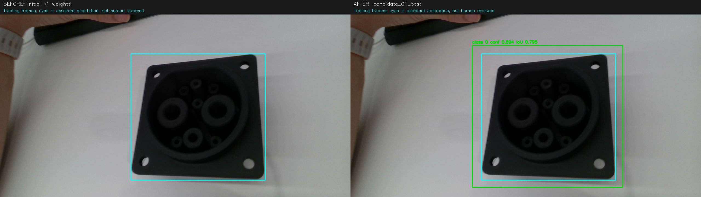
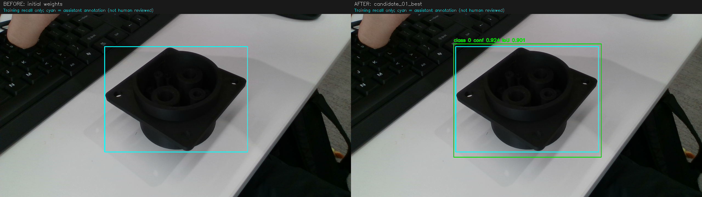
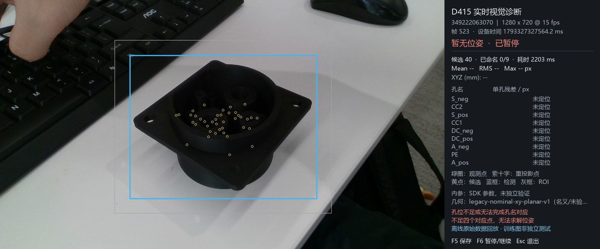
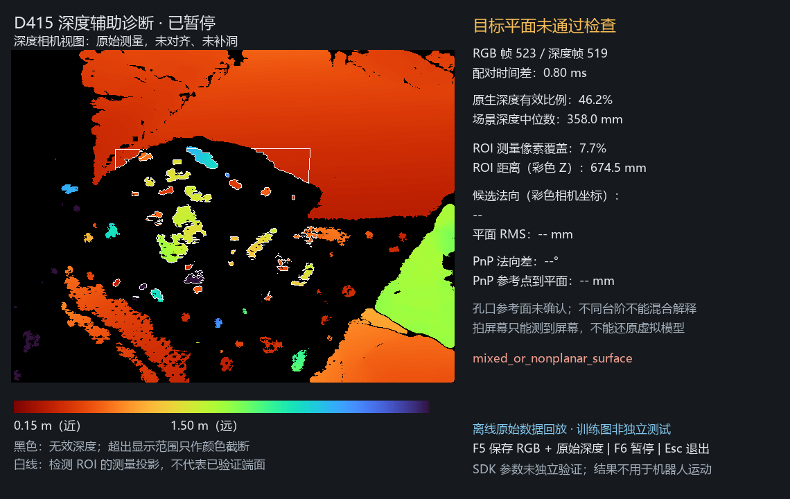

# 黑色打印件 YOLO 微调与深度回放（历史记录）

本文记录 2026-10-30 的两轮历史微调，保留当时数据、权重和结果，不作为当前启动指南。日常使用及新的 197 train / 36 val GPU 训练见 [README](../README.md#数据集与训练)，所有活动入口默认由 `config/vision_model.json` 选择当前模型。

历史 **v2** 在首轮六张黑色样件微调的基础上，再加入三个 D415 会话的 **139 张**实拍图，权重为 `runs/detect_black_20261030_v2/weights/best.pt`。首轮 v1 的权重、数据和下方回放记录保留；当时 D435 配置未随这两轮微调切换。

模型架构仍为 **YOLOv8n**，v1/v2 仅表示微调轮次。后续的 139 张全量九孔诊断及 20 张复核入口见 [九孔诊断与人工复核](black_port_keypoint_diagnosis.md)。

## 本轮 v2：新增数据和结果

| 新采集会话（位于 `artifacts/d415_preview/`） | 图片数 |
| --- | ---: |
| `20261030T031316Z_fa95e685f141415595a6d1bbf4da3b24` | 23 |
| `20261030T031408Z_49e0236dc339467c94b2d1cf626ef52a` | 35 |
| `20261030T031538Z_99879947c6494ae5b7eb56cb9e262678` | 81 |

共 **208 张 train（63 张历史图＋首轮 6 张＋本轮 139 张）和 16 张历史 val**。三次相邻会话统一归入一个训练采集组，没有随机分出新的验证/测试集。139 张框均经过助手目视复核及修订，来源为 `assistant_visual_review`、`human_reviewed=false`，还不是用户人工真值。它们只标目标框，不是九孔中心标注。

其中 **85 张目标部分出画**，框只覆盖可见范围，不推断画外尺寸；可用于检测训练，不能作为完整九孔定位验收。没有新增完全重复图，筛出的 20 对近似相邻帧保留在同一训练组。历史训练中的 5 个完全重复文件仍保留，无跨 train/val 的完全重复图像；这些检查不能证明历史数据具备独立性。

所有源 RGB、原始 Z16、逐帧诊断和相机参数保持原样并通过哈希核对。**YOLO 本轮仍使用 RGB＋框训练，深度只保存在原始会话中；本轮没有重新评估 139 张的深度质量。** 下方六图的深度结论仅属于 v1 数据。

训练从 v1 的 `best.pt` 初始化，使用 CPU、640 输入、batch 8、40 epochs、AdamW、初始学习率 0.0003、余弦调度、冻结前 10 个模块、旋转增强 ±15°、seed 0。它是新一轮微调，不是恢复旧优化器状态；完整设置见本轮 `effective_params.json`。

固定框检测采用 conf 0.25、NMS IoU 0.7；目标命中要求预测框与参考框 IoU≥0.5。每张参考图至多计一个匹配框，其他预测均记额外框（包括唯一但不匹配的预测）。mAP 单独以 conf 0.001、batch 8 在原 16 张 val 上计算。

| 指标 | 初始 v1 | v2 best（该轮选用） | v2 last |
| --- | ---: | ---: | ---: |
| 新增 139 图目标命中（训练回看） | 63/139 | **139/139** | 139/139 |
| 新增 139 图额外框数 | 3 | **1** | 1 |
| 首轮黑色六图目标命中（训练回看） | 6/6 | 6/6 | 6/6 |
| 历史 val 目标命中 | 15/16 | 15/16 | 15/16 |
| 历史 val 额外框数 | 2 | 3 | 1 |
| 历史 val mAP50 | 0.927500 | 0.923125 | 0.927941 |
| 历史 val mAP50–95 | 0.752279 | **0.779517** | 0.726147 |

选用 `best.pt`，其历史 val 的 mAP50–95 高于 `last.pt`，且 139 张新增训练图均有匹配目标框。但 mAP50 略降、历史额外框增加，不能称为所有指标都改善。139/139 是对助手复核框的训练回看，旧 val 也用于开发和选模，**没有新的独立测试准确率**。

下图为新会话第 19 张的实际前后预测：左为初始 v1 漏检，右为 v2 best 检出（置信度约 0.894、与参考框 IoU 约 0.795）；青色为助手复核框，绿色为匹配预测。画廊在候选模型评估前按每会话首/中/末帧及一个 v1 困难样本固定选取，共 12 张，均为训练图。

[](assets/readme/black_connector_v2_detection_comparison.png)

### 实际前端离线检查

使用当时 v2 预览配置、各会话原始 RGB 内参与 `geometry_nominal.json`，经 `vision.preview.process_frame` 检查三张已保存训练图，无相机或机器人连接：

| 图片 | 目标框 | 孔位/PnP 结果 |
| --- | ---: | --- |
| `s1_001` | 1 | 未形成孔名对应，`no_layout_variant`，无位姿 |
| `s1_019`（上图） | 1 | 返回 7 个命名点并算出 PnP，但关联、内点数及残差检查未通过，状态为 `warning` |
| `s3_078` | 2 | 因 `ambiguous_complete_target_use_target_window` 拒绝，无位姿 |

这项检查确认新权重已接入实际前端，多目标歧义仍被拒绝；它不是全量孔位评估，也不表明九孔定位、重投影误差或插装已解决。当前目标选择函数不单独检查出画截断，不能把“检出一个框”当作完整目标可用。

### v2 记录与复现

实验目录：`artifacts/black_port_finetune/20261030_v2/`。

- `training_manifest.json`：224 对图片/标签、源会话、分组、截断标记、深度引用及哈希；各 `session_*/reviewed_boxes*.json` 保存复核框。
- `dataset/` 与 `initial.pt`：冻结数据和初始 v1 权重；`training_params.json`、`effective_params.json`、`train.log`、`training_status.json` 保存设置与成功训练记录。
- `evaluation/comparison.json`：全部检测、分组计数、mAP 与权重哈希；`evaluation/comparison_candidate_01_best/` 保存 12 张前后对照。
- `preview_smoke/summary.json`：上述三帧实际前端检查，明确标记离线训练帧、未回放深度、非独立测试。
- 该轮 best SHA256：`537b5b21ef7184533d18bc9a91acbab33a64bda371bbaccb5150f126a263059b`。

重新评估、检查前端或重训时使用尚不存在的输出名称/attempt，避免覆盖已完成记录：

```powershell
.\.venv\Scripts\python.exe -B -X utf8 artifacts/black_port_finetune/20261030_v2/evaluate_models.py --candidate runs/detect_black_20261030_v2/weights/best.pt --candidate runs/detect_black_20261030_v2/weights/last.pt --output evaluation_repeat --with-map
.\.venv\Scripts\python.exe -B -X utf8 artifacts/black_port_finetune/20261030_v2/preview_smoke.py --output preview_smoke_repeat
.\.venv\Scripts\python.exe -B -X utf8 artifacts/black_port_finetune/20261030_v2/run_training.py --attempt 2
```

本轮脚本、训练数据、报告与权重位于 Git 忽略目录，换电脑需一并复制；`dataset.yaml` 和训练参数包含本机绝对路径，迁移时需另建参数副本并调整路径。这三个会话拍摄时使用旧默认模型；复现实验必须显式指定本节的历史权重和冻结数据，不能使用随训练更新的当前模型代替。

下一批请保留不同拍摄会话的完整样件图作为独立验证，覆盖远近、倾斜和背景变化，再复核目标框。不要把同会话相邻帧同时放入训练和测试。检测框稳定后，继续单独验证小孔提取、孔名关联与 PnP。

## 首轮 v1：六图训练和深度回放留档

以下均为首轮 v1 的历史结果，使用 `runs/detect_black_20261030_v1_attempt2/weights/best.pt`；不代表本轮 139 张新图的深度或孔位表现。首轮从 `runs/detect_reviewed/weights/best.pt` 微调，加入六张 D415 黑色样件图片。

### 深度信息用在哪里

这六组原始采集同时保存了 RGB 和原始 uint16 Z16 深度图，每组绑定双流帧号、时间戳、深度尺度及深度到彩色外参。深度单位换算为 `Z16 × depth_scale_m`，不是把 8 位深度彩图作为测量。

| 环节 | 当前深度用途 |
| --- | --- |
| 本次 YOLO 微调 | 输入 RGB 和目标框；没有把深度作为第四通道或训练标签 |
| 带 `--depth` 的预览 | 将深度投影到彩色相机坐标，在检测 ROI 内统计测量覆盖与 Z 距离，检查候选表面平面 |
| PnP 对照 | 仅在孔位位姿与候选平面均可解时报告法向、距离一致性；当前六图孔名匹配失败，因此没有该项结果 |
| 机器人插装控制 | 深度结果目前只作诊断，没有参与运动放行或替代孔位/PnP |

ROI 距离是框内有效测量的彩色相机 Z 中位数，框中可能包含外壳、台阶及背景，不能直接当作孔口端面的真实距离。

### 检测前后图片

下图是同一张原始训练图片的离线对照。左侧原模型没有预测框；右侧新模型的绿色框为实际 YOLO 预测，置信度约 0.924。两侧青色框均为训练预标框，来源为助手目视标注，尚未经用户人工复核。

[](assets/readme/black_connector_detection_comparison.png)

这张图已参与训练，用于说明模型对该样本的变化，不是新视角的独立测试结果。

### 同组 RGB 与深度回放图片

下面两图来自 2026-10-30 保存的同一组原始数据：RGB 帧 523、深度帧 519，配对时间差约 0.797 ms。使用新 YOLO 权重、原始 Z16、各自内参和深度到彩色外参，通过 SDK 软件帧复用实时入口的点云映射及现有诊断函数；没有连接物理相机，没有滤波、补洞或注入人工检测框。

**RGB 诊断**：目标已有检测框，但九孔尚未命名，PnP 没有位姿输出。

[](assets/readme/black_connector_rgb_replay.png)

**同帧深度诊断**：目标区域存在大面积无效测量。原生深度非零比例为 46.24%，内缩检测 ROI 的测量像素覆盖为 7.67%；两者分母不同，不能混为同一指标。图中 674.5 mm 是混合 ROI 的彩色相机 Z 中位数，不能当作孔口端面距离。

[](assets/readme/black_connector_depth_replay.png)

六组回放的原生深度非零比例为 **44.08%–46.24%**，ROI 测量像素覆盖为 **7.27%–8.18%**。框内 Z 中位数在 **464.9–674.5 mm** 之间变化，六组均因 `mixed_or_nonplanar_surface` 被拒绝，未输出候选法向或 PnP 一致性。覆盖指标还受双流分辨率及投影采样影响，并非物体表面有效率；本组结果不足以提供可靠孔口平面。

深度在这里实际参与了质量检查，但尚未改善孔位定位。不能据此把深度设为可信的插装距离，也不能单凭这些画面确定无效测量的唯一原因。

回放报告与每帧诊断位于 `artifacts/black_port_finetune/20261030_v1/depth_replay/`。每帧 64 个点使用 SDK 标量接口核对，彩色坐标差最大约 `1.91e-6 m`；原记录的有效像素数、投影样本数及场景深度中位数均精确复现，源文件哈希未改变。这些检查验证回放计算的一致性，不是深度测量精度验收。

### 数据与训练

- 原有 63 张 train，加上同一 D415 会话的 6 张新图，共 69 张训练图；原 16 张 val 保持不变。历史 train 中 5 个完全重复文件继续保留，本轮没有改写原数据。没有跨 train/val 的完全重复图像。
- 六张新图来自 `artifacts/d415_preview/20261030T022814Z_70c99eebf68b4566aa45290f73397b57/`，全部属于同一训练组。原采集会话的分区与 `failed` 记录未改写。
- 新框逐张目视确定，沿用旧 `port` 定义，覆盖完整可见法兰、孔面及下部壳体。标注来源为 `assistant_visual_annotation`，`human_reviewed=false`；它们不是九孔中心标注。预标框图为 `artifacts/black_port_finetune/20261030_v1/new_training_boxes.jpg`。
- 使用 CPU、640 输入、batch 8、60 epochs、AdamW、初始学习率 0.001、余弦调度、seed 0；完整参数保存在同目录 `effective_params_attempt2.json`。本次是加载旧权重进行新一轮微调，不是恢复旧优化器状态。
- 六张图均为同视角近邻帧，训练回看不能充当独立测试。旧 val 也已用于历史开发和本次选模；新的不同视角、照明和背景仍待验证。

### 固定数据上的前后对照

固定框检测使用同一原图、640 输入、置信度 0.25、NMS IoU 0.7；正确框按与参考框的 IoU≥0.5 判断。mAP 另以相同的 conf 0.001、batch 8 设置运行，区别于固定阈值命中计数。

| 指标 | 原权重 | 本次 best | 本次 last |
| --- | ---: | ---: | ---: |
| 黑色六图正确检出（训练回看） | 0/6 | 6/6 | 6/6 |
| 原 val 正确检出 | 15/16 | 15/16 | 15/16 |
| 原 val mAP50 | 0.919375 | 0.927500 | 0.923125 |
| 原 val mAP50–95 | 0.782850 | 0.752279 | 0.735231 |

本次选择 `best.pt`，其旧 val mAP50–95 优于 `last.pt`，且黑色六图均能检出。与原权重相比，严格框定位指标仍有下降，不能称为全面提升。六张新图的参考框尚未经用户人工复核。

新权重接入实际孔位前端后，六图均有检测框，但仍未匹配出孔名，原因为 `no_layout_variant`。本次解决了这些训练图片上的目标漏检，没有解决九孔提取、PnP 或重投影误差，也没有验证新视角或实际机器人插装。

### 记录与复现

实验目录：`artifacts/black_port_finetune/20261030_v1/`。

- `training_manifest.json`：全部 85 组图像/标签的来源、分组、框、哈希，以及初始权重哈希。
- `dataset/`：冻结的训练/验证图片和标签，`initial.pt` 为原模型快照。
- `train_attempt2.log`、`training_status_attempt2.json`：成功训练的日志与结果；`runs/detect_black_20261030_v1_attempt2/results.csv` 保存逐轮结果。
- `evaluation_attempt2/comparison.json`：固定检测、mAP、前端结果、参数及权重哈希；同目录 `comparison_candidate_01_best/` 保存六张原图上的前后检测框对照。
- 首次启动的 `train.log` / `training_status.json` 保留沙箱拒绝 Python 本地通信管道的错误；当时未开始训练。第二次在允许该操作的执行环境中完成，无依赖安装、系统配置修改或硬件连接。

重新比较本次权重，输出目录必须是未使用的新名称：

```powershell
.\.venv\Scripts\python.exe -B -X utf8 artifacts/black_port_finetune/20261030_v1/evaluate_models.py --candidate runs/detect_black_20261030_v1_attempt2/weights/best.pt --candidate runs/detect_black_20261030_v1_attempt2/weights/last.pt --output evaluation_repeat --with-map
```

若需从同一冻结数据和原模型重新微调，使用新的 attempt 编号，避免覆盖已有结果：

```powershell
.\.venv\Scripts\python.exe -B -X utf8 artifacts/black_port_finetune/20261030_v1/run_training.py --attempt 3
```

这些本地复现实验脚本随 `artifacts/` 保存，不在 Git 跟踪范围。已有训练和对照评估均为离线运行；启动相机后的新场景表现需另行保存、检查。
